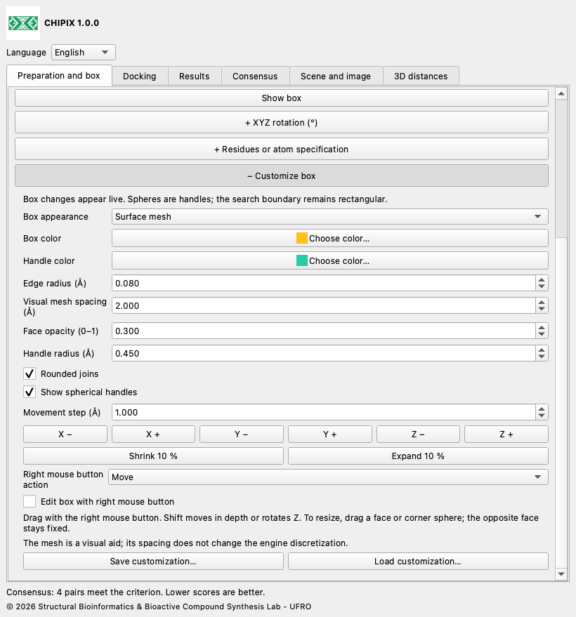
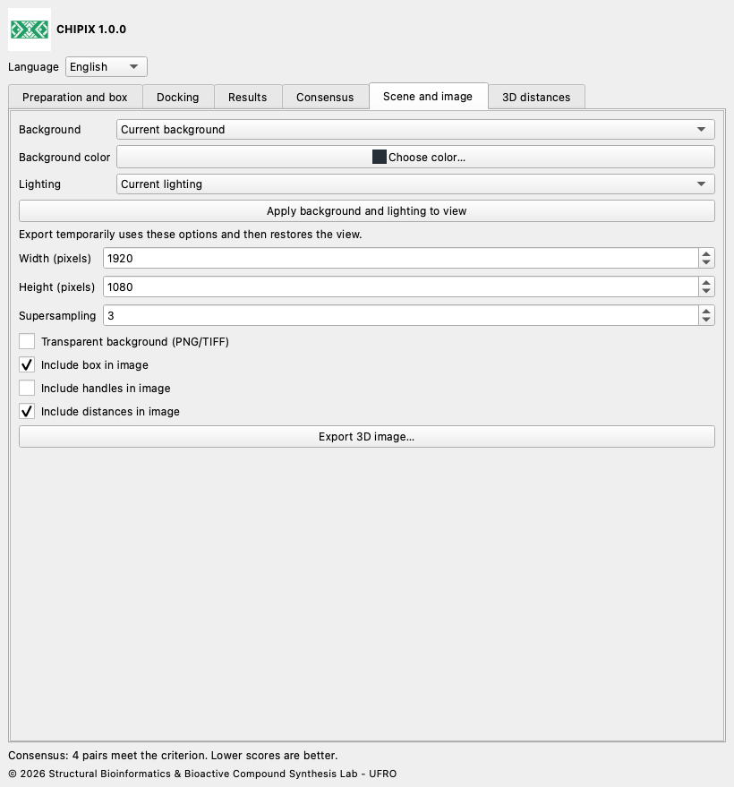

# CHIPIX 1.0.0

## User documentation

[English](docs/en/README.md) · [Español](docs/es/README.md) · [Deutsch](docs/de/README.md) · [Français](docs/fr/README.md) · [简体中文](docs/zh/README.md) · [日本語](docs/ja/README.md) · [Português](docs/pt/README.md)

CHIPIX 1.0.0 is a native ChimeraX plugin from the Structural Bioinformatics & Bioactive Compound Synthesis Lab - UFRO. It combines external Vina/Smina docking, pose inspection and reproducible pairwise consensus in a dockable interface.

## Workflow

1. Open a receptor model. In Preparation and box, open native Dock Prep and review protonation, waters, cofactors and chemical states. Export PDB or a selected ligand as MOL2 when needed.

2. Generate receptor and ligand PDBQT with your validated AutoDockTools or Meeko protocol. PDB/MOL2 export alone does not generate PDBQT.

3. Select binding-site or reference-ligand atoms and define the search box with a positive padding, or enter its center and size in Å. Scene coordinates and external PDBQT coordinates must share the same frame.

4. In Docking, enter the engine executable, files, ligand ID, receptor/frame ID, output folder, exhaustiveness, pose count, energy range, seed and CPU. Reuse the IDs only for the same molecular system. Start docking and inspect the log.

5. In Results, import PDBQT with REMARK VINA RESULT or SDF V2000 with a numeric score field. Automatic fields are minimizedAffinity, SCORE, vina_affinity and affinity; specify a custom field if needed. Import one ligand per file. Lower scores are assumed to be better.

6. In Consensus, select at least two runs of the same ligand and receptor/frame, choose a method, RMSD mode and threshold. Double-click a row to display its two poses. Export results or consensus as CSV.

## Box customization, distances and images

Live box editing: change center and size in Preparation and box. XYZ rotation and residue/atom specification are optional sections, collapsed by default; click their + headers to expand them. Open + Customize box in the same tab for XYZ movement, expand/shrink controls, edge radius, rounded joins, spherical handles, colors and preset save/load. Choose outline, surface mesh, transparent faces or hidden. Collapsing a section preserves its values. Mesh spacing is visual only; it does not set the docking engine grid spacing. Rounded joins do not change the rectangular search boundary.

For interactive editing, enable Edit box with right mouse button and choose Move, Resize from a sphere or Rotate. Drag in the graphics window. Resize a face or corner sphere to keep its opposite face/corner fixed. Shift-drag moves in depth; in Rotate mode it rotates Z. Numeric rotations use degrees, Rz·Ry·Rx. Disable editing to restore the previous right-button bindings; closing CHIPIX restores them too.

For a specific site, enter a native ChimeraX atom specification such as #1/A:45,67-72 and use Fit box to residues. Include entire residues expands an atom-level selection to complete residues. Selection fitting and residue fitting respect the current rotation and padding. All fitting uses scene coordinates. The prepared receptor/ligand PDBQT inputs must already match that scene coordinate frame; CHIPIX does not align unrelated structures.

Rotated docking: Vina/Smina accept axis-aligned search boxes. CHIPIX preserves the original prepared PDBQT files, transforms copies of both receptor and ligand to the box-local frame and runs with center (0,0,0). It then transforms poses back into the original scene frame. run.json records the transform and hashes of local inputs, raw engine output and restored poses. PDBQT coordinates have 0.001 Å precision. Rotation can change map discretization and docking results; identical scores across rotations are not guaranteed. At zero rotation the original direct-engine workflow is preserved.

In 3D distances, select exactly two atoms, including atoms in different models, and measure them. Customize color, line radius, dash count (0 means solid), label size and whether values appear in 3D. Distances and labels refresh as models move. Remove individual distances, clear the CHIPIX group or export CSV. Other ChimeraX distance groups are independent.

In Scene and image, select current, white, black, slate gray or custom background and current, simple, soft, full, flat or default lighting. Apply them to the view for a preview, or export with temporary settings that restore the view afterward. Set pixel width/height and supersampling; choose whether to include the box, handles and distances. PNG/TIFF support a transparent background; JPEG does not. Export captures the 3D scene, without the tool window. A working ChimeraX OpenGL view is required.

Save customization writes a portable JSON preset containing box geometry, appearance, image settings and distance style. Load validates the whole preset before applying it. Image export also writes <image-name>.json with styling and the camera matrix. These records contain no molecular structures, atom selections or camera restoration command: save a ChimeraX session separately to preserve the complete scene. When updating this same 1.0.0 release, install the new wheel with reinstall true and restart ChimeraX.





## Consensus and RMSD

Each pair contains one pose from each of two different runs. Rank by Rank averages ordinal ranks after ascending energy sorting; ties retain file order. AASS averages (score−minimum)/(maximum−minimum). Z-score averages (score−mean)/population standard deviation. Normalization uses all poses in each run. Lower consensus is better. AASS and Z-score are undefined for constant scores; choose Rank by Rank in that case.

RMSD excludes hydrogen and never fits, rotates or translates the ligand. Ordered mode requires matching serial numbers, names, elements and atom order; repeated PDBQT names are supported through serial numbers. Symmetry mode requires SDF bonds and exactly matches graphs labelled by element and connectivity, without bond-order or stereochemical labels. It is limited to 200,000 search nodes per pair; exceeding the limit raises an error rather than returning an approximation. The interactive analysis permits at most 100,000 pairs. No spatial filter compares all pairs and does not demonstrate geometric agreement.

## Files and reproducibility

Each docking folder contains copied receptor/ligand PDBQT inputs, original poses, engine.log and run.json with parameters, UTC timestamps, seed, CPU and SHA-256 hashes. Imports also receive a copied result and a manifest. Restore a completed run by selecting its run.json; keep or move the entire folder together. CSV machine-readable fields remain in English for interoperability. Engine logs retain the engine’s own language. Display PDB files derived from PDBQT have inferred bonds and must not be used for chemical preparation. SDF models use the native reader with explicit bonds.

## Languages

Select English, Español, Deutsch, Français, 简体中文, 日本語 or Português using Language. The choice is remembered.

## Current scope

- Runs rigid Vina and Smina; Vinardo is exposed for Smina. Smina still needs a real-engine validation on the target platform.
- RxDock/ADFR results can be analysed only after conversion to the supported PDBQT/SDF score conventions. Direct RxDock/ADFR execution is not implemented.
- Automatic PDBQT preparation, flexible docking, batch screening, consensus clustering and saving the window in .cxs sessions are not implemented.
- Pairwise consensus is not a global ligand-library ranking. User-provided frame IDs do not prove that external receptors are aligned. Full scientific parity with a PyMOL workflow still requires identical preparation and reference-system validation.

## Validation

The recorded 1iep test used official prepared inputs and Vina 1.2.7. Four poses from the native-tool run matched direct Vina output exactly: maximum energy difference 0, maximum ordered RMSD 0 Å and identical PDBQT SHA-256. Numerical tests compare consensus equations with a retained upstream reference. Native Qt integration is tested with an isolated temporary profile; the offscreen test does not validate OpenGL rendering. Branding, translation and packaging checks are additional release tests.

compare_results.py compares same-engine PyMOL and CHIPIX outputs by ascending-score rank. Use identical prepared inputs, binary, scoring, box, seed, CPU and search parameters. Energy and RMSD tolerances are configurable comparison criteria, not biological-quality thresholds. Exit codes: 0 pass, 1 discrepancy, 2 invalid input.

```bash
python3 compare_results.py pymol.pdbqt chipix.pdbqt \
  --energy-tolerance 0.001 --rmsd-tolerance 0.01 --report comparison.json
```

## Build and tests

Run these commands from the plugin root. Use ChimeraX’s Python for building and native integration tests. Pure standard-library tests run with a regular Python; upstream formula tests require NumPy, already present in the tested ChimeraX. The source repository is self-contained.

```bash
python3 -m unittest discover -s tests -v
# ChimeraX Python:
python3.11 build_bundle.py
python3.11 tests/chimerax_smoke.py
```

## License and citation

CHIPIX code is GPL-3.0-or-later; see LICENSE and NOTICE. The original DockingPie workflow and scoring equations are credited to Serena Rosignoli and Alessandro Paiardini. Cite their 2022 Bioinformatics publication, doi:10.1093/bioinformatics/btac452, and the engines used. Vina is a separate program under its included Apache-2.0 license.

© 2026 Structural Bioinformatics & Bioactive Compound Synthesis Lab - UFRO
