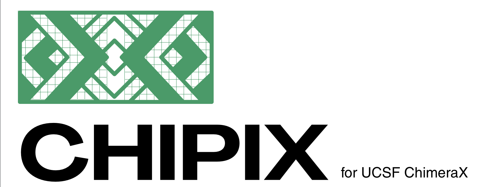
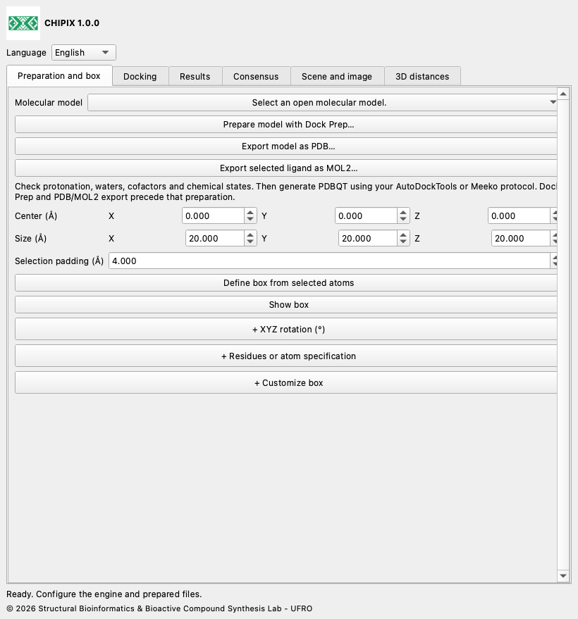

# CHIPIX



**Molecular docking and pose consensus in ChimeraX**

CHIPIX is a native ChimeraX plugin from the Structural Bioinformatics & Bioactive Compound Synthesis Lab - UFRO. It combines external Vina/Smina docking, pose inspection and reproducible pairwise consensus in a dockable interface.

[English](docs/en/README.md) · [Español](docs/es/README.md) · [Deutsch](docs/de/README.md) · [Français](docs/fr/README.md) · [简体中文](docs/zh/README.md) · [日本語](docs/ja/README.md) · [Português](docs/pt/README.md)

## Features

- Dock Prep integration; PDB/MOL2 export and a search box from selected atoms.
- Asynchronous rigid Vina/Smina jobs, cancellation and complete logs.
- PDBQT/SDF pose import, native model display and CSV export.
- Rank by Rank, AASS and Z-score consensus; ordered or symmetry-corrected heavy-atom RMSD.

## Box customization, distances and images

Live box editing: change center and size in Preparation and box. XYZ rotation and residue/atom specification are optional sections, collapsed by default; click their + headers to expand them. Open + Customize box in the same tab for XYZ movement, expand/shrink controls, edge radius, rounded joins, spherical handles, colors and preset save/load. Choose outline, surface mesh, transparent faces or hidden. Collapsing a section preserves its values. Mesh spacing is visual only; it does not set the docking engine grid spacing. Rounded joins do not change the rectangular search boundary.

## Installation

Download CHIPIX-1.0.0.zip and extract it. Locate the folder containing bundle_info.xml, README.md and dist/.

Open ChimeraX and display its command line.

Run the installation command below, replacing the path with the actual extracted folder. Use the wheel in dist/.

```text
toolshed install "/FULL/PATH/CHIPIX-1.0.0/dist/chimerax_chipix-1.0.0-py3-none-any.whl"
chipix
```

Select English, Español, Deutsch, Français, 简体中文, 日本語 or Português using Language. The choice is remembered.

[Installation](docs/en/INSTALLATION.md) · [User documentation](docs/en/DOCUMENTATION.md)



## Requirements

ChimeraX 1.8 or later is required. Integration was tested on ChimeraX 1.12 with Python 3.11 and Qt6 on macOS Apple Silicon. Other operating systems and ChimeraX versions need validation. Analysis and import use the Python standard library. Running docking additionally requires a compatible external Vina or Smina executable and prepared PDBQT inputs.

This source ZIP includes the official Vina 1.2.7 executable for macOS Apple Silicon in engines/. The wheel contains the plugin only. For Windows, Linux or Intel Macs, obtain the matching engine from its official release and select it with Browse. Smina is configured separately. If a copied macOS/Linux binary lacks execute permission, use chmod +x on that executable in a terminal.

## Current scope

- Runs rigid Vina and Smina; Vinardo is exposed for Smina. Smina still needs a real-engine validation on the target platform.
- RxDock/ADFR results can be analysed only after conversion to the supported PDBQT/SDF score conventions. Direct RxDock/ADFR execution is not implemented.
- Automatic PDBQT preparation, flexible docking, batch screening, consensus clustering and saving the window in .cxs sessions are not implemented.
- Pairwise consensus is not a global ligand-library ranking. User-provided frame IDs do not prove that external receptors are aligned. Full scientific parity with a PyMOL workflow still requires identical preparation and reference-system validation.

## Validation

The recorded 1iep test used official prepared inputs and Vina 1.2.7. Four poses from the native-tool run matched direct Vina output exactly: maximum energy difference 0, maximum ordered RMSD 0 Å and identical PDBQT SHA-256. Numerical tests compare consensus equations with a retained upstream reference. Native Qt integration is tested with an isolated temporary profile; the offscreen test does not validate OpenGL rendering. Branding, translation and packaging checks are additional release tests.

## GitHub

For GitHub, extract the ZIP and upload the contents of its CHIPIX-1.0.0 folder as the repository root. Attach the wheel from dist/ to a GitHub Release so users can install it directly. Publishing is performed by the repository owner; no GitHub URL is assumed.

## License and citation

CHIPIX code is GPL-3.0-or-later; see LICENSE and NOTICE. The original DockingPie workflow and scoring equations are credited to Serena Rosignoli and Alessandro Paiardini. Cite their 2022 Bioinformatics publication, doi:10.1093/bioinformatics/btac452, and the engines used. Vina is a separate program under its included Apache-2.0 license.

[DockingPie publication](https://doi.org/10.1093/bioinformatics/btac452) · [ChimeraX bundles](https://chimerax.readthedocs.io/en/latest/writing_bundles.html) · [AutoDock Vina](https://github.com/ccsb-scripps/AutoDock-Vina/releases/tag/v1.2.7)

© 2026 Structural Bioinformatics & Bioactive Compound Synthesis Lab - UFRO
