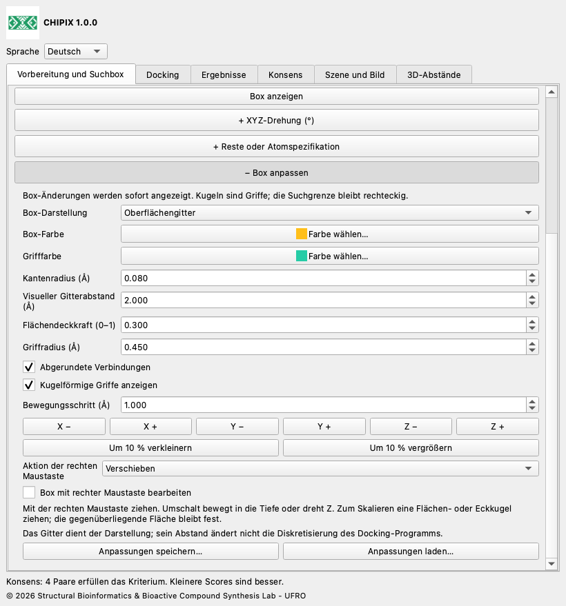
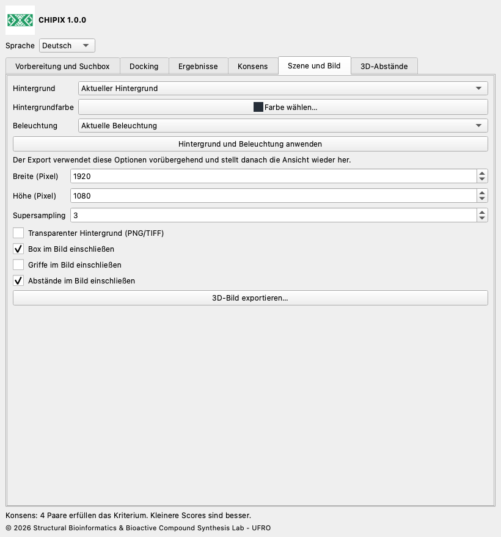

# CHIPIX 1.0.0

## Benutzerdokumentation

[English](../../docs/en/README.md) · [Español](../../docs/es/README.md) · [Deutsch](../../docs/de/README.md) · [Français](../../docs/fr/README.md) · [简体中文](../../docs/zh/README.md) · [日本語](../../docs/ja/README.md) · [Português](../../docs/pt/README.md)

CHIPIX 1.0.0 ist ein natives ChimeraX-Plugin des Structural Bioinformatics & Bioactive Compound Synthesis Lab - UFRO. Es vereint externes Vina-/Smina-Docking, Posenansicht und reproduzierbaren paarweisen Konsens in einem andockbaren Fenster.

## Arbeitsablauf

1. Rezeptormodell öffnen. Unter Vorbereitung und Suchbox Dock Prep öffnen und Protonierung, Wasser, Cofaktoren und chemische Zustände prüfen. Bei Bedarf PDB oder einen ausgewählten Liganden als MOL2 exportieren.

2. Rezeptor- und Liganden-PDBQT mit einem validierten AutoDockTools- oder Meeko-Protokoll erzeugen. PDB-/MOL2-Export allein erzeugt kein PDBQT.

3. Bindungsstellen- oder Referenzligandenatome auswählen und die Suchbox mit positivem Rand definieren oder Mittelpunkt und Größe in Å eingeben. Szene und externe PDBQT-Dateien müssen dasselbe Koordinatensystem verwenden.

4. Unter Docking Engine, Dateien, Liganden-ID, Rezeptor-/Koordinatensystem-ID, Ausgabeordner, Suchintensität, Posenanzahl, Energiebereich, Zufallsstartwert und CPU angeben. IDs nur für dasselbe molekulare System wiederverwenden. Docking starten und Protokoll prüfen.

5. Unter Ergebnisse PDBQT mit REMARK VINA RESULT oder SDF V2000 mit numerischem Score importieren. Automatische Felder: minimizedAffinity, SCORE, vina_affinity, affinity. Eigene Felder können angegeben werden. Ein Ligand pro Datei; kleinere Scores gelten als besser.

6. Unter Konsens mindestens zwei Läufe desselben Liganden und Rezeptors/Koordinatensystems auswählen. Methode, RMSD-Modus und Grenzwert festlegen. Ein Doppelklick zeigt beide Posen. Ergebnisse oder Konsens als CSV exportieren.

## Box anpassen, Abstände und Bilder

Live-Bearbeitung: Mittelpunkt und Größe unter Vorbereitung und Box ändern. XYZ-Drehung und Reste oder Atomspezifikation sind optionale, anfangs eingeklappte Abschnitte; ihre +-Kopfzeilen öffnen sie. + Box anpassen in derselben Registerkarte enthält XYZ-Bewegung, Vergrößern/Verkleinern, Kantenradius, abgerundete Verbindungen, Kugelgriffe, Farben und Speichern/Laden. Umriss, Oberflächengitter, transparente Flächen oder ausgeblendet wählen. Einklappen behält die Werte bei. Der visuelle Gitterabstand ändert nicht das Rechengitter des Docking-Programms. Abgerundete Verbindungen erhalten die rechteckige Suchgrenze.

Box mit rechter Maustaste bearbeiten aktivieren und Verschieben, An einer Kugel skalieren oder Drehen wählen. In der 3D-Ansicht ziehen. Beim Ziehen einer Flächen- oder Eckkugel bleibt die gegenüberliegende Fläche/Ecke fest. Umschalt bewegt in die Tiefe bzw. dreht im Drehmodus Z. Numerische Winkel sind Grad mit Rz·Ry·Rx. Beim Deaktivieren oder Schließen werden die vorherigen Belegungen der rechten Maustaste wiederhergestellt.

Eine ChimeraX-Atomspezifikation wie #1/A:45,67-72 eingeben und Box an Reste anpassen wählen. Vollständige Reste einschließen erweitert eine Atomauswahl auf ganze Reste. Anpassung an Auswahl und Reste berücksichtigt die aktuelle Drehung und den Randabstand und verwendet Szenenkoordinaten. Vorbereitete Rezeptor-/Ligand-PDBQT-Dateien müssen bereits im selben Koordinatensystem liegen; CHIPIX richtet unabhängige Strukturen nicht aus.

Gedrehtes Docking: Vina/Smina erwarten achsenparallele Boxen. CHIPIX behält die Original-PDBQT-Dateien, transformiert Rezeptor- und Ligandkopien in das lokale Box-System und rechnet mit Mittelpunkt (0,0,0). Posen werden anschließend zurücktransformiert. run.json enthält Transformation und SHA-256 für lokale Eingaben, rohe Programmausgabe und zurücktransformierte Posen. PDBQT-Koordinaten haben 0,001 Å Genauigkeit. Drehungen können Kartendiskretisierung und Ergebnisse verändern; gleiche Scores sind nicht garantiert. Ohne Drehung bleibt der bisherige direkte Ablauf erhalten.

Unter 3D-Abstände genau zwei Atome auswählen, auch aus verschiedenen Modellen, und messen. Farbe, Linienradius, Strichzahl (0 für durchgehend), Schriftgröße und 3D-Werte lassen sich anpassen. Werte folgen Modellbewegungen. Einzelne Abstände entfernen, CHIPIX-Gruppe leeren oder CSV exportieren. Andere ChimeraX-Abstandsgruppen sind unabhängig.

Unter Szene und Bild mit aktuellem, weißem, schwarzem, schiefergrauem oder eigenem Hintergrund sowie aktueller, einfacher, weicher, voller, flacher oder Standardbeleuchtung exportieren. Einstellungen zur Vorschau anwenden oder nur vorübergehend für den Export nutzen; die Ansicht wird danach wiederhergestellt. Pixelmaße, Supersampling sowie Box, Griffe und Abstände wählen. Transparenz erfordert PNG/TIFF, nicht JPEG. Exportiert wird die 3D-Szene ohne Werkzeugfenster. Eine funktionierende OpenGL-Ansicht ist erforderlich.

Anpassungen speichern erstellt eine portable JSON-Datei mit Box, Darstellung, Bildoptionen und Abstandsstil. Laden prüft die gesamte Datei vor der Anwendung. Beim Bildexport entsteht zusätzlich <Bildname>.json mit Stil und Kameramatrix. Molekülmodelle, Atomauswahlen und eine Kamerawiederherstellung sind nicht enthalten; die vollständige Szene separat als ChimeraX-Sitzung speichern. Zum Aktualisieren dieser Version 1.0.0 das neue Wheel mit reinstall true installieren und ChimeraX neu starten.





## Konsens und RMSD

Jedes Paar enthält je eine Pose aus zwei verschiedenen Läufen. Das Rangmittel mittelt die Ränge nach aufsteigender Energie; bei Gleichstand gilt die Dateireihenfolge. AASS mittelt (Score−Minimum)/(Maximum−Minimum). Z-Score mittelt (Score−Mittelwert)/Populationsstandardabweichung. Alle Posen jedes Laufs gehen in die Normalisierung ein. Kleinere Konsenswerte sind besser. AASS und Z-Score sind bei konstanten Scores nicht definiert; dann Rangmittel wählen.

RMSD schließt Wasserstoff aus und passt, dreht oder verschiebt den Liganden nicht. Der geordnete Modus verlangt übereinstimmende Seriennummern, Namen, Elemente und Reihenfolge; wiederholte PDBQT-Namen werden über Seriennummern unterschieden. Der Symmetriemodus benötigt SDF-Bindungen und vergleicht Graphen exakt nach Element und Konnektivität, ohne Bindungsordnungs- oder Stereochemieetiketten. Grenze: 200 000 Suchknoten pro Paar. Bei Überschreitung folgt ein Fehler statt einer Näherung. Die interaktive Analyse erlaubt höchstens 100 000 Paare. Ohne räumlichen Filter werden alle Paare verglichen; das belegt keine geometrische Übereinstimmung.

## Dateien und Reproduzierbarkeit

Jeder Laufordner enthält kopierte Rezeptor-/Liganden-PDBQT, ursprüngliche Posen, engine.log und run.json mit Parametern, UTC-Zeitangaben, Zufallsstartwert, CPU und SHA-256. Importe erhalten ebenfalls Kopie und Manifest. Abgeschlossene Läufe mit run.json laden und den gesamten Ordner gemeinsam aufbewahren oder verschieben. CSV-Feldnamen bleiben für den Austausch englisch; Engine-Protokolle behalten ihre Originalsprache. Aus PDBQT erzeugte PDB-Anzeigen haben abgeleitete Bindungen und dürfen nicht zur chemischen Vorbereitung dienen. SDF wird nativ mit expliziten Bindungen gelesen.

## Sprachen

Unter Sprache English, Español, Deutsch, Français, 简体中文, 日本語 oder Português wählen. Die Auswahl wird gespeichert.

## Aktueller Funktionsumfang

- Starres Vina und Smina werden ausgeführt; Vinardo wird für Smina angeboten. Smina benötigt noch eine Validierung mit der realen Engine auf der Zielplattform.
- RxDock-/ADFR-Ergebnisse lassen sich nach Konvertierung in unterstützte Formate und Score-Konventionen analysieren. Direkte Ausführung ist nicht implementiert.
- Automatische PDBQT-Vorbereitung, flexibles Docking, Stapelscreening, Konsens-Clustering und Fensterspeicherung in .cxs-Sitzungen fehlen.
- Paarweiser Konsens ist kein globales Bibliotheksranking. Benutzerdefinierte Koordinatensystem-IDs beweisen keine Rezeptorausrichtung. Vollständige wissenschaftliche Gleichwertigkeit mit PyMOL erfordert identische Vorbereitung und Referenzvalidierung.

## Validierung

Der dokumentierte 1iep-Test verwendete offizielle vorbereitete Eingaben und Vina 1.2.7. Vier Posen des nativen Werkzeugs stimmten exakt mit direktem Vina überein: maximale Energiedifferenz 0, maximales geordnetes RMSD 0 Å und identisches PDBQT-SHA-256. Numerische Tests vergleichen die Konsensformeln mit einer erhaltenen Originalreferenz. Native Qt-Tests verwenden ein isoliertes temporäres Profil; der Test ohne Bildschirm validiert kein OpenGL-Rendering. Branding, Übersetzungen und Paketierung werden zusätzlich geprüft.

compare_results.py vergleicht Ausgaben derselben Engine aus PyMOL und CHIPIX nach aufsteigendem Score-Rang. Identische Eingaben, Binärdatei, Bewertungsfunktion, Suchbox, Zufallsstartwert, CPU und Suchparameter verwenden. Energie-/RMSD-Toleranzen sind Vergleichskriterien und keine biologischen Qualitätsgrenzen. Rückgabecodes: 0 bestanden, 1 Abweichung, 2 ungültige Eingabe.

```bash
python3 compare_results.py pymol.pdbqt chipix.pdbqt \
  --energy-tolerance 0.001 --rmsd-tolerance 0.01 --report comparison.json
```

## Erstellen und Testen

Diese Befehle im Plugin-Hauptordner ausführen. Zum Erstellen und für native Tests ChimeraX-Python verwenden. Standardbibliothekstests laufen mit regulärem Python; Originalformeltests benötigen NumPy, das im getesteten ChimeraX enthalten ist. Das Quellrepository ist eigenständig.

```bash
python3 -m unittest discover -s tests -v
# ChimeraX Python:
python3.11 build_bundle.py
python3.11 tests/chimerax_smoke.py
```

## Lizenz und Zitation

CHIPIX-Code steht unter GPL-3.0-or-later; siehe LICENSE und NOTICE. Der ursprüngliche DockingPie-Ablauf und die Formeln stammen von Serena Rosignoli und Alessandro Paiardini. Ihre Bioinformatics-Publikation von 2022, doi:10.1093/bioinformatics/btac452, sowie die verwendeten Engines zitieren. Vina ist ein separates Programm mit beigefügter Apache-2.0-Lizenz.

© 2026 Structural Bioinformatics & Bioactive Compound Synthesis Lab - UFRO
