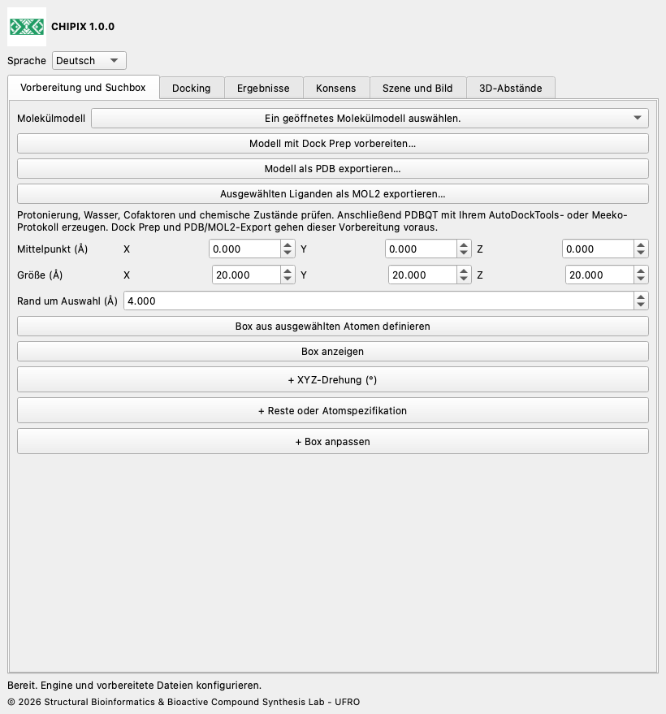

# CHIPIX 1.0.0

**Molekulares Docking und Posenkonsens in ChimeraX**

CHIPIX 1.0.0 ist ein natives ChimeraX-Plugin des Structural Bioinformatics & Bioactive Compound Synthesis Lab - UFRO. Es vereint externes Vina-/Smina-Docking, Posenansicht und reproduzierbaren paarweisen Konsens in einem andockbaren Fenster.

[English](../../docs/en/README.md) · [Español](../../docs/es/README.md) · [Deutsch](../../docs/de/README.md) · [Français](../../docs/fr/README.md) · [简体中文](../../docs/zh/README.md) · [日本語](../../docs/ja/README.md) · [Português](../../docs/pt/README.md)

## Funktionen

- Dock-Prep-Integration, PDB-/MOL2-Export und Suchbox aus ausgewählten Atomen.
- Asynchrone starre Vina-/Smina-Läufe mit Abbruch und vollständigen Protokollen.
- PDBQT-/SDF-Import, native Molekülmodelle und CSV-Export.
- Rangmittel, AASS und Z-Score-Konsens; geordnetes oder symmetriekorrigiertes Schweratom-RMSD.

## Box anpassen, Abstände und Bilder

Live-Bearbeitung: Mittelpunkt und Größe unter Vorbereitung und Box ändern. XYZ-Drehung und Reste oder Atomspezifikation sind optionale, anfangs eingeklappte Abschnitte; ihre +-Kopfzeilen öffnen sie. + Box anpassen in derselben Registerkarte enthält XYZ-Bewegung, Vergrößern/Verkleinern, Kantenradius, abgerundete Verbindungen, Kugelgriffe, Farben und Speichern/Laden. Umriss, Oberflächengitter, transparente Flächen oder ausgeblendet wählen. Einklappen behält die Werte bei. Der visuelle Gitterabstand ändert nicht das Rechengitter des Docking-Programms. Abgerundete Verbindungen erhalten die rechteckige Suchgrenze.

## Installation

CHIPIX-1.0.0.zip herunterladen und entpacken. Den Ordner mit bundle_info.xml, README.md und dist/ finden.

ChimeraX öffnen und die Befehlszeile einblenden.

Den folgenden Installationsbefehl ausführen und den Pfad durch den tatsächlichen entpackten Ordner ersetzen. Die Wheel-Datei aus dist/ verwenden.

```text
toolshed install "/FULL/PATH/CHIPIX-1.0.0/dist/chimerax_chipix-1.0.0-py3-none-any.whl"
chipix
```

Unter Sprache English, Español, Deutsch, Français, 简体中文, 日本語 oder Português wählen. Die Auswahl wird gespeichert.

[Installation](../../docs/de/INSTALLATION.md) · [Benutzerdokumentation](../../docs/de/DOCUMENTATION.md)



## Voraussetzungen

ChimeraX ab Version 1.8 ist erforderlich. Getestet wurde die Integration mit ChimeraX 1.12, Python 3.11 und Qt6 auf macOS Apple Silicon. Andere Systeme und Versionen müssen validiert werden. Analyse und Import verwenden die Python-Standardbibliothek. Zum Docking sind zusätzlich eine passende externe Vina- oder Smina-Datei und vorbereitete PDBQT-Eingaben nötig.

Dieses Quell-ZIP enthält die offizielle Vina-1.2.7-Datei für macOS Apple Silicon unter engines/. Das Wheel enthält nur das Plugin. Für Windows, Linux oder Intel-Macs die passende offizielle Engine herunterladen und mit Durchsuchen auswählen. Smina wird separat konfiguriert. Fehlen einer kopierten Datei unter macOS/Linux Ausführungsrechte, im Terminal chmod +x auf diese Datei anwenden.

## Aktueller Funktionsumfang

- Starres Vina und Smina werden ausgeführt; Vinardo wird für Smina angeboten. Smina benötigt noch eine Validierung mit der realen Engine auf der Zielplattform.
- RxDock-/ADFR-Ergebnisse lassen sich nach Konvertierung in unterstützte Formate und Score-Konventionen analysieren. Direkte Ausführung ist nicht implementiert.
- Automatische PDBQT-Vorbereitung, flexibles Docking, Stapelscreening, Konsens-Clustering und Fensterspeicherung in .cxs-Sitzungen fehlen.
- Paarweiser Konsens ist kein globales Bibliotheksranking. Benutzerdefinierte Koordinatensystem-IDs beweisen keine Rezeptorausrichtung. Vollständige wissenschaftliche Gleichwertigkeit mit PyMOL erfordert identische Vorbereitung und Referenzvalidierung.

## Validierung

Der dokumentierte 1iep-Test verwendete offizielle vorbereitete Eingaben und Vina 1.2.7. Vier Posen des nativen Werkzeugs stimmten exakt mit direktem Vina überein: maximale Energiedifferenz 0, maximales geordnetes RMSD 0 Å und identisches PDBQT-SHA-256. Numerische Tests vergleichen die Konsensformeln mit einer erhaltenen Originalreferenz. Native Qt-Tests verwenden ein isoliertes temporäres Profil; der Test ohne Bildschirm validiert kein OpenGL-Rendering. Branding, Übersetzungen und Paketierung werden zusätzlich geprüft.

## GitHub

Für GitHub das ZIP entpacken und den Inhalt von CHIPIX-1.0.0 als Repository-Hauptverzeichnis hochladen. Das Wheel aus dist/ an eine GitHub Release anhängen. Die Veröffentlichung übernimmt der Repository-Eigentümer; eine GitHub-Adresse wird nicht vorausgesetzt.

## Lizenz und Zitation

CHIPIX-Code steht unter GPL-3.0-or-later; siehe LICENSE und NOTICE. Der ursprüngliche DockingPie-Ablauf und die Formeln stammen von Serena Rosignoli und Alessandro Paiardini. Ihre Bioinformatics-Publikation von 2022, doi:10.1093/bioinformatics/btac452, sowie die verwendeten Engines zitieren. Vina ist ein separates Programm mit beigefügter Apache-2.0-Lizenz.

[DockingPie publication](https://doi.org/10.1093/bioinformatics/btac452) · [ChimeraX bundles](https://chimerax.readthedocs.io/en/latest/writing_bundles.html) · [AutoDock Vina](https://github.com/ccsb-scripps/AutoDock-Vina/releases/tag/v1.2.7)

© 2026 Structural Bioinformatics & Bioactive Compound Synthesis Lab - UFRO
