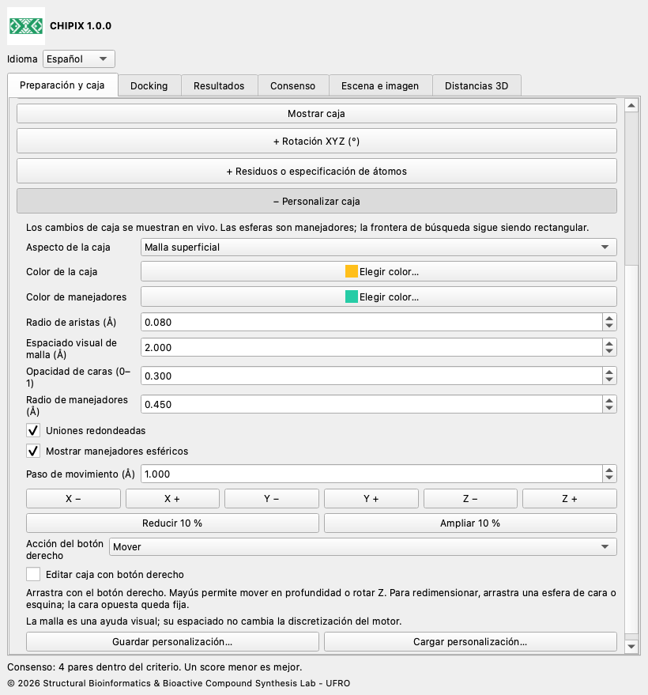
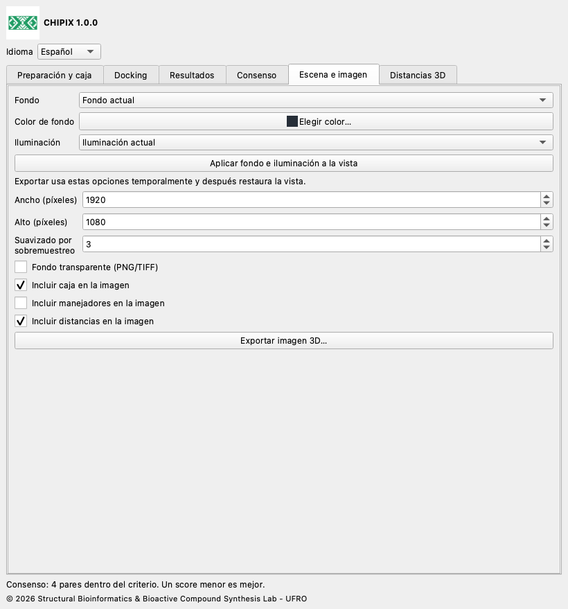

# CHIPIX 1.0.0

## Documentación de uso

[English](../../docs/en/README.md) · [Español](../../docs/es/README.md) · [Deutsch](../../docs/de/README.md) · [Français](../../docs/fr/README.md) · [简体中文](../../docs/zh/README.md) · [日本語](../../docs/ja/README.md) · [Português](../../docs/pt/README.md)

CHIPIX 1.0.0 es un complemento nativo de ChimeraX del Structural Bioinformatics & Bioactive Compound Synthesis Lab - UFRO. Reúne docking con Vina/Smina externos, inspección de poses y consenso reproducible por pares en una ventana acoplable.

## Flujo de trabajo

1. Abre el receptor. En Preparación y caja, abre Dock Prep y revisa protonación, aguas, cofactores y estados químicos. Exporta PDB o el ligando seleccionado como MOL2 si lo necesitas.

2. Genera los PDBQT del receptor y del ligando con tu protocolo validado de AutoDockTools o Meeko. Exportar PDB/MOL2 por sí solo no genera PDBQT.

3. Selecciona átomos del sitio o del ligando de referencia y define la caja con margen positivo, o introduce centro y tamaño en Å. La escena y los PDBQT externos deben usar el mismo marco de coordenadas.

4. En Docking, indica ejecutable, archivos, ID de ligando, ID de receptor/marco, carpeta, exhaustividad, poses, rango energético, semilla y CPU. Reutiliza los IDs sólo para el mismo sistema molecular. Ejecuta y revisa el registro.

5. En Resultados, importa PDBQT con REMARK VINA RESULT o SDF V2000 con score numérico. Los campos automáticos son minimizedAffinity, SCORE, vina_affinity y affinity; puedes indicar otro campo. Importa un ligando por archivo. Se interpreta que menor score es mejor.

6. En Consenso, selecciona al menos dos ejecuciones del mismo ligando y receptor/marco, y elige método, modo RMSD y umbral. Un doble clic muestra las dos poses. Exporta resultados o consenso como CSV.

## Personalización de caja, distancias e imágenes

Edición en vivo: cambia centro y tamaño en Preparación y caja. Rotación XYZ y Residuos o especificación de átomos son secciones opcionales, plegadas al inicio; pulsa sus encabezados + para ampliarlas. Abre + Personalizar caja en esa misma pestaña para movimiento XYZ, ampliación/reducción, radio de aristas, uniones redondeadas, manejadores esféricos, colores y guardar/cargar personalizaciones. Elige contorno, malla superficial, caras transparentes u oculta. Plegar una sección conserva sus valores. El espaciado de malla es visual; no establece el espaciado computacional del motor. Las uniones redondeadas conservan la frontera rectangular de búsqueda.

Activa Editar caja con botón derecho y elige Mover, Redimensionar desde una esfera o Rotar. Arrastra dentro de la vista 3D. Para cambiar tamaño arrastra una esfera de cara o esquina; su cara/esquina opuesta queda fija. Mayús permite mover en profundidad; en modo Rotar cambia Z. Las rotaciones numéricas usan grados y Rz·Ry·Rx. Desactivar la edición o cerrar CHIPIX restaura las asignaciones anteriores del botón derecho.

Para un sitio concreto escribe una especificación nativa de ChimeraX, por ejemplo #1/A:45,67-72, y pulsa Definir caja desde residuos. Incluir residuos completos amplía una selección de átomos a sus residuos completos. El ajuste desde residuos y desde selección respeta la rotación y el margen actuales y usa coordenadas de escena. Los PDBQT preparados de receptor y ligando deben corresponder ya a ese marco; CHIPIX no alinea estructuras distintas.

Docking con rotación: Vina/Smina aceptan cajas alineadas con los ejes. CHIPIX conserva los PDBQT originales, transforma copias del receptor y ligando al marco local de la caja y ejecuta con centro (0,0,0). Después devuelve las poses al marco original. run.json registra la transformación y los SHA-256 de entradas locales, salida cruda del motor y poses restauradas. PDBQT tiene precisión de coordenadas de 0,001 Å. La rotación puede cambiar la discretización de mapas y los resultados; no garantiza puntuaciones idénticas entre orientaciones. Con rotación cero se conserva el flujo de ejecución directa anterior.

En Distancias 3D selecciona exactamente dos átomos, incluso de modelos distintos, y mídelos. Personaliza color, radio de línea, número de guiones (0 es línea continua), tamaño de etiqueta y visibilidad de valores 3D. Distancias y etiquetas se actualizan al mover modelos. Puedes eliminar una distancia, limpiar el grupo CHIPIX o exportar CSV. Los otros grupos de distancias de ChimeraX son independientes.

En Escena e imagen elige fondo actual, blanco, negro, gris pizarra o personalizado, e iluminación actual, simple, suave, completa, plana o predeterminada. Aplica los ajustes a la vista para previsualizar, o exporta con aplicación temporal y restauración posterior. Configura ancho/alto en píxeles, sobremuestreo e inclusión de caja, manejadores y distancias. PNG/TIFF admiten fondo transparente; JPEG no. Se captura la escena 3D sin la ventana del complemento. Se necesita una vista OpenGL funcional en ChimeraX.

Guardar personalización genera un JSON portátil con geometría de caja, aspecto, ajustes de imagen y estilo de distancias. Cargar valida todo el archivo antes de aplicarlo. Exportar imagen también crea <nombre-imagen>.json con estilo y matriz de cámara. Estos registros no contienen estructuras moleculares, selecciones de átomos ni una orden para restaurar la cámara: guarda una sesión de ChimeraX por separado para conservar toda la escena. Para actualizar esta misma versión 1.0.0, instala el nuevo wheel con reinstall true y reinicia ChimeraX.





## Consenso y RMSD

Cada par contiene una pose de cada una de dos ejecuciones diferentes. Rank by Rank promedia rangos tras ordenar por energía ascendente; los empates conservan el orden del archivo. AASS promedia (score−mínimo)/(máximo−mínimo). Z-score promedia (score−media)/desviación estándar poblacional. La normalización usa todas las poses de cada ejecución. Menor consenso es mejor. AASS y Z-score no están definidos para scores constantes; en ese caso usa Rank by Rank.

El RMSD excluye hidrógenos y no ajusta, rota ni traslada el ligando. El modo por orden requiere números de serie, nombres, elementos y orden coincidentes; admite nombres PDBQT repetidos mediante los números de serie. El modo por simetría requiere enlaces SDF y compara exactamente grafos etiquetados por elemento y conectividad, sin etiquetas de orden de enlace ni estereoquímica. Tiene un límite de 200 000 nodos por par: al excederlo muestra un error, sin devolver una aproximación. El análisis interactivo admite hasta 100 000 pares. Sin filtro espacial compara todos los pares y no demuestra acuerdo geométrico.

## Archivos y reproducibilidad

Cada carpeta contiene copias de receptor y ligando PDBQT, poses originales, engine.log y run.json con parámetros, fechas UTC, semilla, CPU y hashes SHA-256. Las importaciones también conservan copia y manifiesto. Recupera una ejecución completada con su run.json y conserva o mueve la carpeta entera. Los campos CSV permanecen en inglés para facilitar el intercambio. El registro del motor conserva su idioma original. Los PDB derivados de PDBQT son de visualización, tienen enlaces inferidos y no deben usarse como preparación química. Los modelos SDF usan el lector nativo y enlaces explícitos.

## Idiomas

Elige English, Español, Deutsch, Français, 简体中文, 日本語 o Português en Idioma. La elección queda guardada.

## Alcance actual

- Ejecuta Vina y Smina rígidos; Vinardo se ofrece para Smina. Smina aún necesita validación con un motor real en la plataforma de destino.
- Los resultados RxDock/ADFR pueden analizarse tras convertirlos a los formatos y convenciones de score admitidos. Su ejecución directa no está implementada.
- No están implementados la preparación automática PDBQT, docking flexible, cribado por lotes, clustering de consenso ni guardado de la ventana en sesiones .cxs.
- El consenso por pares no es un ranking global de bibliotecas. Los IDs de marco declarados por el usuario no demuestran alineamiento. La paridad científica completa con PyMOL exige preparación idéntica y validación del sistema de referencia.

## Validación

La prueba registrada con 1iep usó entradas preparadas oficiales y Vina 1.2.7. Las cuatro poses del complemento coincidieron exactamente con Vina directo: diferencia energética máxima 0, RMSD máximo por orden 0 Å y PDBQT idénticos por SHA-256. Las pruebas numéricas contrastan las fórmulas con una referencia original conservada. La integración Qt usa un perfil temporal aislado; la prueba sin pantalla no valida el renderizado OpenGL. Esta versión añade comprobaciones de identidad, traducciones y empaquetado.

compare_results.py compara salidas del mismo motor desde PyMOL y CHIPIX por rango de score ascendente. Usa entradas preparadas, binario, puntuación, caja, semilla, CPU y parámetros idénticos. Las tolerancias de energía y RMSD son criterios de comparación configurables, no umbrales de calidad biológica. Códigos de salida: 0 correcto, 1 discrepancia, 2 entrada inválida.

```bash
python3 compare_results.py pymol.pdbqt chipix.pdbqt \
  --energy-tolerance 0.001 --rmsd-tolerance 0.01 --report comparison.json
```

## Compilación y pruebas

Ejecuta estos comandos desde la raíz del complemento. Usa el Python de ChimeraX para compilar y para la integración nativa. Las pruebas de biblioteca estándar funcionan con un Python normal; las de fórmulas originales requieren NumPy, presente en el ChimeraX probado. El repositorio de código es independiente.

```bash
python3 -m unittest discover -s tests -v
# ChimeraX Python:
python3.11 build_bundle.py
python3.11 tests/chimerax_smoke.py
```

## Licencia y citas

El código CHIPIX usa GPL-3.0-or-later; consulta LICENSE y NOTICE. El flujo y las fórmulas originales de DockingPie se atribuyen a Serena Rosignoli y Alessandro Paiardini. Cita su publicación de Bioinformatics de 2022, doi:10.1093/bioinformatics/btac452, y los motores utilizados. Vina es un programa separado bajo su licencia Apache-2.0 incluida.

© 2026 Structural Bioinformatics & Bioactive Compound Synthesis Lab - UFRO
