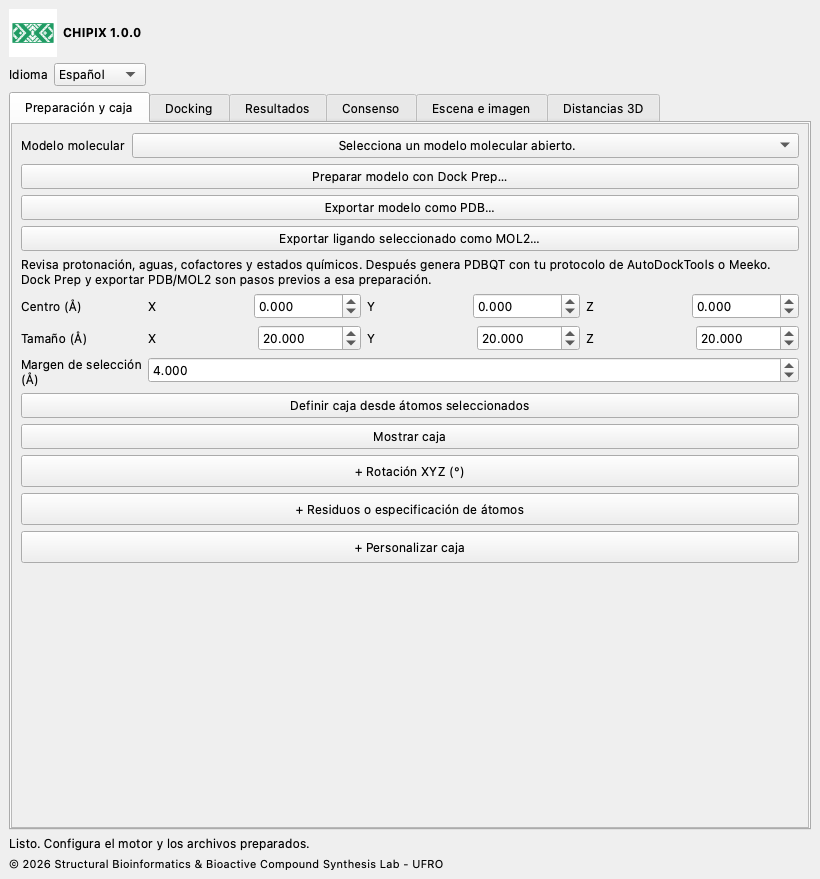

# CHIPIX 1.0.0

**Acoplamiento molecular y consenso de poses en ChimeraX**

CHIPIX 1.0.0 es un complemento nativo de ChimeraX del Structural Bioinformatics & Bioactive Compound Synthesis Lab - UFRO. Reúne docking con Vina/Smina externos, inspección de poses y consenso reproducible por pares en una ventana acoplable.

[English](../../docs/en/README.md) · [Español](../../docs/es/README.md) · [Deutsch](../../docs/de/README.md) · [Français](../../docs/fr/README.md) · [简体中文](../../docs/zh/README.md) · [日本語](../../docs/ja/README.md) · [Português](../../docs/pt/README.md)

## Funciones

- Integración con Dock Prep; exportación PDB/MOL2 y caja desde átomos seleccionados.
- Docking rígido Vina/Smina sin bloquear la interfaz, cancelación y registro completo.
- Importación de poses PDBQT/SDF, modelos nativos y exportación CSV.
- Consenso Rank by Rank, AASS y Z-score; RMSD de átomos pesados por orden o corregido por simetría.

## Personalización de caja, distancias e imágenes

Edición en vivo: cambia centro y tamaño en Preparación y caja. Rotación XYZ y Residuos o especificación de átomos son secciones opcionales, plegadas al inicio; pulsa sus encabezados + para ampliarlas. Abre + Personalizar caja en esa misma pestaña para movimiento XYZ, ampliación/reducción, radio de aristas, uniones redondeadas, manejadores esféricos, colores y guardar/cargar personalizaciones. Elige contorno, malla superficial, caras transparentes u oculta. Plegar una sección conserva sus valores. El espaciado de malla es visual; no establece el espaciado computacional del motor. Las uniones redondeadas conservan la frontera rectangular de búsqueda.

## Instalación

Descarga CHIPIX-1.0.0.zip y descomprímelo. Localiza la carpeta que contiene bundle_info.xml, README.md y dist/.

Abre ChimeraX y muestra su línea de comandos.

Ejecuta el comando de instalación siguiente, sustituyendo la ruta por la carpeta extraída. Usa el archivo wheel de dist/.

```text
toolshed install "/FULL/PATH/CHIPIX-1.0.0/dist/chimerax_chipix-1.0.0-py3-none-any.whl"
chipix
```

Elige English, Español, Deutsch, Français, 简体中文, 日本語 o Português en Idioma. La elección queda guardada.

[Instalación](../../docs/es/INSTALLATION.md) · [Documentación de uso](../../docs/es/DOCUMENTATION.md)



## Requisitos

Requiere ChimeraX 1.8 o posterior. La integración se probó con ChimeraX 1.12, Python 3.11 y Qt6 en macOS Apple Silicon. Otros sistemas y versiones necesitan validación. El análisis y la importación usan la biblioteca estándar de Python. Para ejecutar docking se necesita además un Vina o Smina compatible y entradas PDBQT preparadas.

Este ZIP de código incluye el ejecutable oficial Vina 1.2.7 para macOS Apple Silicon en engines/. El wheel contiene únicamente el complemento. Para Windows, Linux o Mac Intel, obtén el motor correspondiente desde su distribución oficial y selecciónalo con Examinar. Smina se configura aparte. Si un ejecutable copiado en macOS/Linux no tiene permiso de ejecución, aplica chmod +x a ese archivo desde una terminal.

## Alcance actual

- Ejecuta Vina y Smina rígidos; Vinardo se ofrece para Smina. Smina aún necesita validación con un motor real en la plataforma de destino.
- Los resultados RxDock/ADFR pueden analizarse tras convertirlos a los formatos y convenciones de score admitidos. Su ejecución directa no está implementada.
- No están implementados la preparación automática PDBQT, docking flexible, cribado por lotes, clustering de consenso ni guardado de la ventana en sesiones .cxs.
- El consenso por pares no es un ranking global de bibliotecas. Los IDs de marco declarados por el usuario no demuestran alineamiento. La paridad científica completa con PyMOL exige preparación idéntica y validación del sistema de referencia.

## Validación

La prueba registrada con 1iep usó entradas preparadas oficiales y Vina 1.2.7. Las cuatro poses del complemento coincidieron exactamente con Vina directo: diferencia energética máxima 0, RMSD máximo por orden 0 Å y PDBQT idénticos por SHA-256. Las pruebas numéricas contrastan las fórmulas con una referencia original conservada. La integración Qt usa un perfil temporal aislado; la prueba sin pantalla no valida el renderizado OpenGL. Esta versión añade comprobaciones de identidad, traducciones y empaquetado.

## GitHub

Para GitHub, descomprime el ZIP y sube el contenido de CHIPIX-1.0.0 como raíz del repositorio. Adjunta el wheel de dist/ a una GitHub Release para facilitar la instalación. La publicación la realiza el propietario del repositorio; no se presupone una URL de GitHub.

## Licencia y citas

El código CHIPIX usa GPL-3.0-or-later; consulta LICENSE y NOTICE. El flujo y las fórmulas originales de DockingPie se atribuyen a Serena Rosignoli y Alessandro Paiardini. Cita su publicación de Bioinformatics de 2022, doi:10.1093/bioinformatics/btac452, y los motores utilizados. Vina es un programa separado bajo su licencia Apache-2.0 incluida.

[DockingPie publication](https://doi.org/10.1093/bioinformatics/btac452) · [ChimeraX bundles](https://chimerax.readthedocs.io/en/latest/writing_bundles.html) · [AutoDock Vina](https://github.com/ccsb-scripps/AutoDock-Vina/releases/tag/v1.2.7)

© 2026 Structural Bioinformatics & Bioactive Compound Synthesis Lab - UFRO
