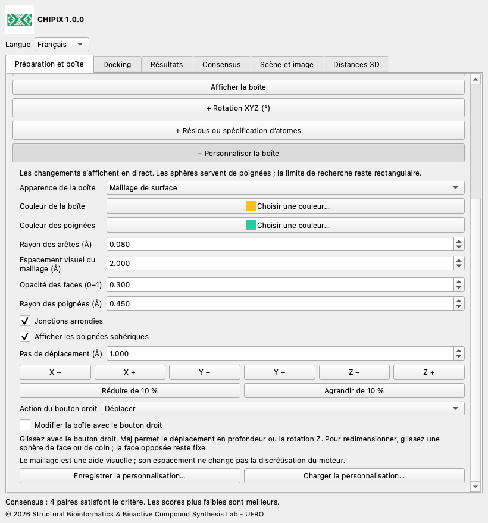
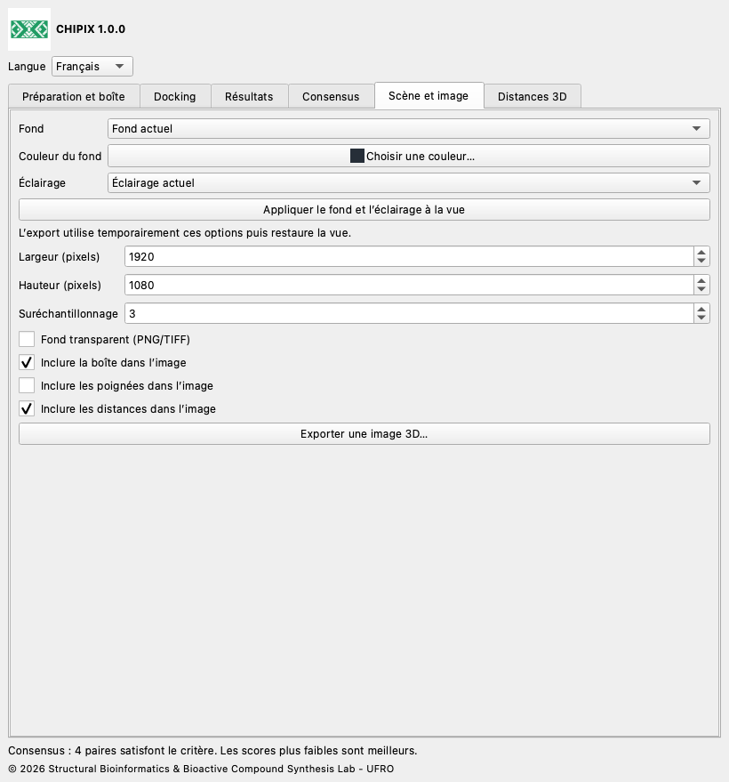

# CHIPIX 1.0.0

## Documentation utilisateur

[English](../../docs/en/README.md) · [Español](../../docs/es/README.md) · [Deutsch](../../docs/de/README.md) · [Français](../../docs/fr/README.md) · [简体中文](../../docs/zh/README.md) · [日本語](../../docs/ja/README.md) · [Português](../../docs/pt/README.md)

CHIPIX 1.0.0 est un plugin natif ChimeraX du Structural Bioinformatics & Bioactive Compound Synthesis Lab - UFRO. Il réunit docking externe Vina/Smina, inspection des poses et consensus reproductible par paires dans une fenêtre ancrable.

## Procédure

1. Ouvrez le récepteur. Dans Préparation et boîte, ouvrez Dock Prep et vérifiez protonation, eaux, cofacteurs et états chimiques. Exportez le modèle en PDB ou le ligand sélectionné en MOL2 si nécessaire.

2. Générez les PDBQT du récepteur et du ligand avec votre protocole validé AutoDockTools ou Meeko. L’export PDB/MOL2 seul ne génère pas de PDBQT.

3. Sélectionnez les atomes du site ou du ligand de référence et définissez la boîte avec une marge positive, ou saisissez centre et dimensions en Å. La scène et les PDBQT externes doivent partager le même repère.

4. Dans Docking, renseignez exécutable, fichiers, identifiants du ligand et du récepteur/repère, dossier, exhaustivité, nombre de poses, plage énergétique, graine et CPU. Réutilisez les identifiants uniquement pour le même système moléculaire. Lancez le calcul et consultez le journal.

5. Dans Résultats, importez PDBQT avec REMARK VINA RESULT ou SDF V2000 avec un score numérique. Champs automatiques : minimizedAffinity, SCORE, vina_affinity, affinity. Un champ personnalisé peut être indiqué. Importez un ligand par fichier. Les scores plus faibles sont considérés comme meilleurs.

6. Dans Consensus, sélectionnez au moins deux calculs du même ligand et récepteur/repère. Choisissez méthode, mode RMSD et seuil. Un double-clic affiche les deux poses. Exportez résultats ou consensus en CSV.

## Personnalisation de la boîte, distances et images

Édition en direct : modifiez centre et taille dans Préparation et boîte. Rotation XYZ et Résidus ou spécification d’atomes sont des sections facultatives, repliées au départ ; cliquez sur leur en-tête + pour les ouvrir. + Personnaliser la boîte, dans le même onglet, contient déplacement XYZ, agrandissement/réduction, rayon des arêtes, jonctions arrondies, poignées sphériques, couleurs et enregistrement/chargement. Choisissez contour, maillage de surface, faces transparentes ou masquée. Replier conserve les valeurs. L’espacement visuel ne règle pas la grille du moteur. Les jonctions arrondies conservent une limite rectangulaire.

Activez Modifier la boîte avec le bouton droit et choisissez Déplacer, Redimensionner avec une sphère ou Tourner. Glissez dans la vue 3D. Une sphère de face ou de coin redimensionne en fixant la face/le coin opposé. Maj déplace en profondeur ou tourne Z en mode rotation. Les angles numériques utilisent des degrés et Rz·Ry·Rx. Désactiver ce mode ou fermer CHIPIX restaure les anciennes affectations du bouton droit.

Pour un site précis, saisissez une spécification ChimeraX telle que #1/A:45,67-72 puis Ajuster la boîte aux résidus. Inclure les résidus entiers étend une sélection atomique aux résidus complets. L’ajustement par sélection ou résidus respecte rotation et marge actuelles, en coordonnées de scène. Les PDBQT préparés du récepteur et du ligand doivent déjà partager ce repère ; CHIPIX n’aligne pas des structures indépendantes.

Docking orienté : Vina/Smina utilisent des boîtes alignées sur les axes. CHIPIX conserve les PDBQT originaux, transforme des copies du récepteur et du ligand dans le repère local et calcule avec centre (0,0,0). Les poses sont ensuite ramenées au repère de scène. run.json enregistre transformation et SHA-256 des entrées locales, sortie brute et poses restaurées. La précision PDBQT est de 0,001 Å. La rotation peut modifier la discrétisation des cartes et les résultats ; des scores identiques ne sont pas garantis. À rotation nulle, le flux direct précédent est conservé.

Dans Distances 3D, sélectionnez exactement deux atomes, éventuellement de modèles différents, puis mesurez. Personnalisez couleur, rayon, tirets (0 pour continu), taille des étiquettes et valeurs 3D. Les distances suivent les mouvements des modèles. Supprimez une mesure, effacez le groupe CHIPIX ou exportez un CSV. Les autres groupes de distances ChimeraX restent indépendants.

Dans Scène et image, choisissez un fond actuel, blanc, noir, gris ardoise ou personnalisé et un éclairage actuel, simple, doux, complet, plat ou par défaut. Appliquez-les pour prévisualiser, ou exportez avec application temporaire et restauration de la vue. Réglez dimensions en pixels, suréchantillonnage et inclusion de boîte, poignées et distances. PNG/TIFF acceptent la transparence ; JPEG ne l’accepte pas. L’image contient la scène 3D sans la fenêtre du complément. Une vue OpenGL fonctionnelle est requise.

Enregistrer la personnalisation crée un JSON portable contenant géométrie, aspect, paramètres d’image et style des distances. Le chargement valide tout le fichier avant application. L’export écrit aussi <nom-image>.json avec style et matrice de caméra. Ces fichiers ne contiennent ni molécules, ni sélections, ni commande de restauration de caméra : enregistrez séparément une session ChimeraX pour préserver la scène complète. Pour actualiser cette version 1.0.0, installez le nouveau wheel avec reinstall true puis redémarrez ChimeraX.





## Consensus et RMSD

Chaque paire contient une pose de chacun de deux calculs différents. La moyenne des rangs utilise les rangs par énergie croissante ; les ex æquo conservent l’ordre du fichier. AASS moyenne (score−minimum)/(maximum−minimum). Le score Z moyenne (score−moyenne)/écart-type de population. La normalisation utilise toutes les poses de chaque calcul. Un consensus plus faible est meilleur. AASS et le score Z ne sont pas définis pour des scores constants ; utilisez alors la moyenne des rangs.

Le RMSD exclut les hydrogènes et n’ajuste, ne tourne ni ne translate le ligand. Le mode ordonné exige les mêmes numéros de série, noms, éléments et ordre ; les noms PDBQT répétés sont distingués par leurs numéros. Le mode symétrie exige des liaisons SDF et compare exactement des graphes étiquetés par élément et connectivité, sans ordre de liaison ni étiquette stéréochimique. Limite : 200 000 nœuds de recherche par paire ; son dépassement produit une erreur, jamais une approximation. L’analyse interactive accepte au plus 100 000 paires. Sans filtre spatial, toutes les paires sont comparées sans prouver un accord géométrique.

## Fichiers et reproductibilité

Chaque dossier conserve copies PDBQT du récepteur/ligand, poses originales, engine.log et run.json avec paramètres, dates UTC, graine, CPU et SHA-256. Les imports reçoivent aussi une copie et un manifeste. Restaurez un calcul terminé avec son run.json et conservez ou déplacez le dossier entier. Les champs CSV restent en anglais pour l’interopérabilité ; le journal du moteur garde sa langue originale. Les PDB dérivés de PDBQT servent à l’affichage, avec liaisons inférées, et ne doivent pas servir à préparer la chimie. Les SDF sont lus nativement avec leurs liaisons explicites.

## Langues

Choisissez English, Español, Deutsch, Français, 简体中文, 日本語 ou Português dans Langue. Ce choix est mémorisé.

## Fonctionnalités actuelles

- Exécute Vina et Smina rigides ; Vinardo est proposé pour Smina. Smina nécessite encore une validation réelle sur la plateforme cible.
- Les résultats RxDock/ADFR peuvent être analysés après conversion vers les formats et conventions de score pris en charge. Leur exécution directe n’est pas implémentée.
- La préparation PDBQT automatique, le docking flexible, le criblage par lots, le clustering de consensus et la sauvegarde de la fenêtre dans les sessions .cxs ne sont pas implémentés.
- Le consensus par paires n’est pas un classement global de bibliothèque. Les identifiants de repère déclarés ne prouvent pas l’alignement des récepteurs. La parité scientifique complète avec PyMOL exige une préparation identique et un système de référence validé.

## Validation

Le test 1iep enregistré utilise les entrées préparées officielles et Vina 1.2.7. Les quatre poses de l’outil natif correspondent exactement à Vina direct : différence énergétique maximale 0, RMSD ordonné maximal 0 Å et SHA-256 PDBQT identique. Les tests numériques comparent les équations à une référence originale conservée. L’intégration Qt utilise un profil temporaire isolé ; le test sans écran ne valide pas le rendu OpenGL. L’identité, les traductions et le conditionnement font l’objet de tests supplémentaires.

compare_results.py compare les sorties du même moteur depuis PyMOL et CHIPIX par rang de score croissant. Utilisez entrées préparées, binaire, score, boîte, graine, CPU et paramètres identiques. Les tolérances énergie/RMSD sont des critères de comparaison configurables, pas des seuils de qualité biologique. Codes de sortie : 0 succès, 1 différence, 2 entrée invalide.

```bash
python3 compare_results.py pymol.pdbqt chipix.pdbqt \
  --energy-tolerance 0.001 --rmsd-tolerance 0.01 --report comparison.json
```

## Compilation et tests

Exécutez ces commandes depuis la racine du plugin. Utilisez Python de ChimeraX pour la compilation et l’intégration native. Les tests standard fonctionnent avec un Python normal ; les tests des formules originales nécessitent NumPy, présent dans ChimeraX testé. Le dépôt source est autonome.

```bash
python3 -m unittest discover -s tests -v
# ChimeraX Python:
python3.11 build_bundle.py
python3.11 tests/chimerax_smoke.py
```

## Licence et citations

Le code CHIPIX est sous GPL-3.0-or-later ; voir LICENSE et NOTICE. Le flux et les équations de DockingPie sont attribués à Serena Rosignoli et Alessandro Paiardini. Citez leur publication Bioinformatics de 2022, doi:10.1093/bioinformatics/btac452, ainsi que les moteurs utilisés. Vina est un programme distinct sous sa licence Apache-2.0 incluse.

© 2026 Structural Bioinformatics & Bioactive Compound Synthesis Lab - UFRO
