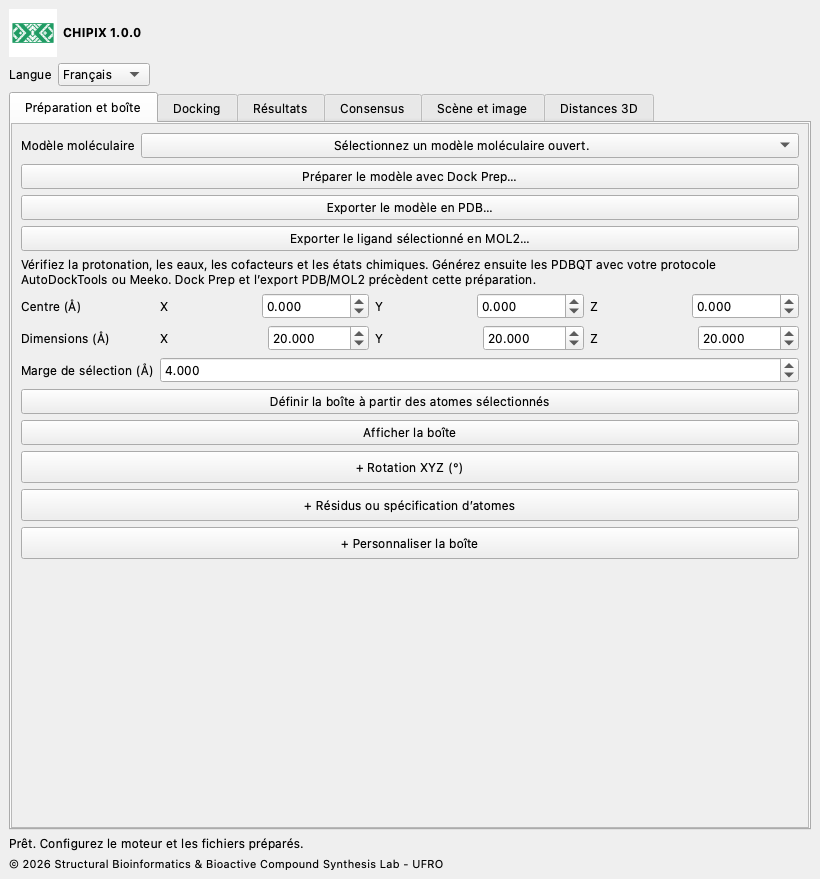

# CHIPIX 1.0.0

**Docking moléculaire et consensus de poses dans ChimeraX**

CHIPIX 1.0.0 est un plugin natif ChimeraX du Structural Bioinformatics & Bioactive Compound Synthesis Lab - UFRO. Il réunit docking externe Vina/Smina, inspection des poses et consensus reproductible par paires dans une fenêtre ancrable.

[English](../../docs/en/README.md) · [Español](../../docs/es/README.md) · [Deutsch](../../docs/de/README.md) · [Français](../../docs/fr/README.md) · [简体中文](../../docs/zh/README.md) · [日本語](../../docs/ja/README.md) · [Português](../../docs/pt/README.md)

## Fonctions

- Intégration Dock Prep, export PDB/MOL2 et boîte définie à partir des atomes sélectionnés.
- Calculs Vina/Smina rigides asynchrones, annulation et journaux complets.
- Import de poses PDBQT/SDF, modèles natifs et export CSV.
- Consensus par moyenne des rangs, AASS et scores Z ; RMSD des atomes lourds ordonné ou corrigé par symétrie.

## Personnalisation de la boîte, distances et images

Édition en direct : modifiez centre et taille dans Préparation et boîte. Rotation XYZ et Résidus ou spécification d’atomes sont des sections facultatives, repliées au départ ; cliquez sur leur en-tête + pour les ouvrir. + Personnaliser la boîte, dans le même onglet, contient déplacement XYZ, agrandissement/réduction, rayon des arêtes, jonctions arrondies, poignées sphériques, couleurs et enregistrement/chargement. Choisissez contour, maillage de surface, faces transparentes ou masquée. Replier conserve les valeurs. L’espacement visuel ne règle pas la grille du moteur. Les jonctions arrondies conservent une limite rectangulaire.

## Installation

Téléchargez CHIPIX-1.0.0.zip et décompressez-le. Repérez le dossier contenant bundle_info.xml, README.md et dist/.

Ouvrez ChimeraX et affichez sa ligne de commande.

Exécutez la commande d’installation ci-dessous en remplaçant le chemin par celui du dossier extrait. Utilisez le wheel dans dist/.

```text
toolshed install "/FULL/PATH/CHIPIX-1.0.0/dist/chimerax_chipix-1.0.0-py3-none-any.whl"
chipix
```

Choisissez English, Español, Deutsch, Français, 简体中文, 日本語 ou Português dans Langue. Ce choix est mémorisé.

[Installation](../../docs/fr/INSTALLATION.md) · [Documentation utilisateur](../../docs/fr/DOCUMENTATION.md)



## Prérequis

ChimeraX 1.8 ou ultérieur est requis. L’intégration a été testée sur ChimeraX 1.12, Python 3.11 et Qt6 sous macOS Apple Silicon. Les autres systèmes et versions restent à valider. L’analyse et l’import utilisent la bibliothèque standard Python. L’exécution du docking nécessite un exécutable externe Vina ou Smina compatible et des entrées PDBQT préparées.

Ce ZIP source contient le binaire officiel Vina 1.2.7 pour macOS Apple Silicon dans engines/. Le wheel contient uniquement le plugin. Pour Windows, Linux ou Mac Intel, obtenez le binaire officiel adapté et sélectionnez-le avec Parcourir. Smina se configure séparément. Si un binaire copié sous macOS/Linux n’a pas la permission d’exécution, appliquez chmod +x à ce fichier dans un terminal.

## Fonctionnalités actuelles

- Exécute Vina et Smina rigides ; Vinardo est proposé pour Smina. Smina nécessite encore une validation réelle sur la plateforme cible.
- Les résultats RxDock/ADFR peuvent être analysés après conversion vers les formats et conventions de score pris en charge. Leur exécution directe n’est pas implémentée.
- La préparation PDBQT automatique, le docking flexible, le criblage par lots, le clustering de consensus et la sauvegarde de la fenêtre dans les sessions .cxs ne sont pas implémentés.
- Le consensus par paires n’est pas un classement global de bibliothèque. Les identifiants de repère déclarés ne prouvent pas l’alignement des récepteurs. La parité scientifique complète avec PyMOL exige une préparation identique et un système de référence validé.

## Validation

Le test 1iep enregistré utilise les entrées préparées officielles et Vina 1.2.7. Les quatre poses de l’outil natif correspondent exactement à Vina direct : différence énergétique maximale 0, RMSD ordonné maximal 0 Å et SHA-256 PDBQT identique. Les tests numériques comparent les équations à une référence originale conservée. L’intégration Qt utilise un profil temporaire isolé ; le test sans écran ne valide pas le rendu OpenGL. L’identité, les traductions et le conditionnement font l’objet de tests supplémentaires.

## GitHub

Pour GitHub, décompressez le ZIP et téléversez le contenu de CHIPIX-1.0.0 à la racine du dépôt. Joignez le wheel de dist/ à une GitHub Release. La publication est effectuée par le propriétaire du dépôt ; aucune URL GitHub n’est présumée.

## Licence et citations

Le code CHIPIX est sous GPL-3.0-or-later ; voir LICENSE et NOTICE. Le flux et les équations de DockingPie sont attribués à Serena Rosignoli et Alessandro Paiardini. Citez leur publication Bioinformatics de 2022, doi:10.1093/bioinformatics/btac452, ainsi que les moteurs utilisés. Vina est un programme distinct sous sa licence Apache-2.0 incluse.

[DockingPie publication](https://doi.org/10.1093/bioinformatics/btac452) · [ChimeraX bundles](https://chimerax.readthedocs.io/en/latest/writing_bundles.html) · [AutoDock Vina](https://github.com/ccsb-scripps/AutoDock-Vina/releases/tag/v1.2.7)

© 2026 Structural Bioinformatics & Bioactive Compound Synthesis Lab - UFRO
