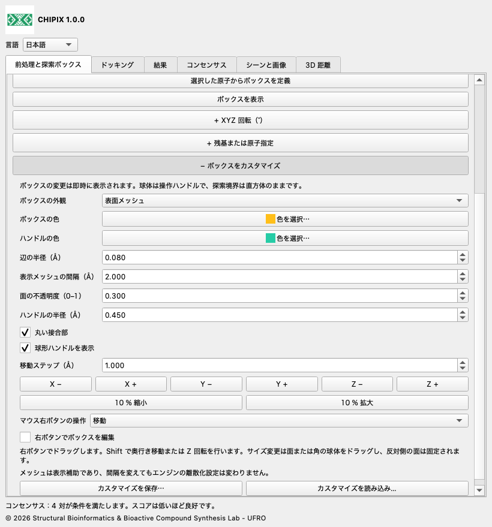
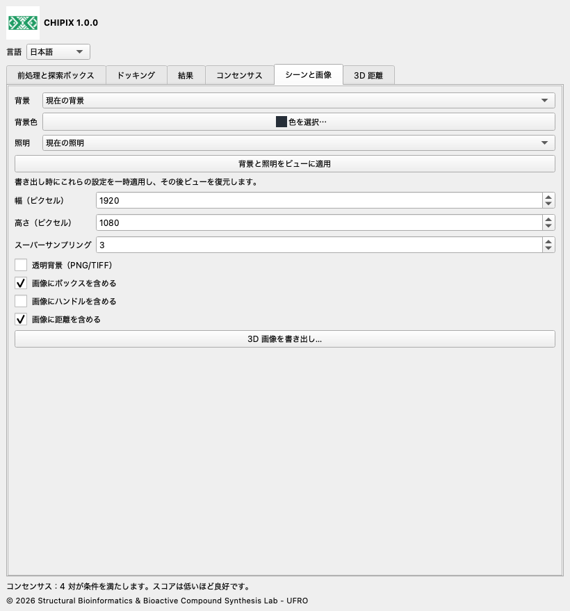

# CHIPIX 1.0.0

## ユーザーガイド

[English](../../docs/en/README.md) · [Español](../../docs/es/README.md) · [Deutsch](../../docs/de/README.md) · [Français](../../docs/fr/README.md) · [简体中文](../../docs/zh/README.md) · [日本語](../../docs/ja/README.md) · [Português](../../docs/pt/README.md)

CHIPIX 1.0.0 は Structural Bioinformatics & Bioactive Compound Synthesis Lab - UFRO による ChimeraX のネイティブプラグインです。外部 Vina/Smina によるドッキング、ポーズの確認、再現可能な対ごとのコンセンサス解析をドッキング可能なウィンドウに統合します。

## 操作手順

1. 受容体モデルを開きます。前処理と探索ボックスで Dock Prep を開き、プロトン化、水分子、補因子、化学状態を確認します。必要に応じて PDB または選択リガンドの MOL2 を書き出します。

2. 検証済みの AutoDockTools または Meeko の手順で受容体とリガンドの PDBQT を生成します。PDB/MOL2 の書き出しだけでは PDBQT は生成されません。

3. 結合部位または参照リガンドの原子を選択して正の余白で探索ボックスを作成するか、中心とサイズを Å 単位で入力します。シーンと外部 PDBQT は同じ座標系である必要があります。

4. ドッキングで実行ファイル、入力、リガンド ID、受容体・座標系 ID、保存先、探索の徹底度、ポーズ数、エネルギー範囲、乱数シード、CPU を設定します。ID は同じ分子系にのみ再利用します。実行してログを確認します。

5. 結果で REMARK VINA RESULT を含む PDBQT、または数値スコアを持つ SDF V2000 を読み込みます。自動フィールドは minimizedAffinity、SCORE、vina_affinity、affinity で、別のフィールドも指定できます。ファイルごとに 1 リガンドを読み込み、スコアは低いほど良いと扱います。

6. コンセンサスで同じリガンドと受容体・座標系の実行を 2 つ以上選択し、手法、RMSD モード、閾値を指定します。行をダブルクリックすると 2 つのポーズを表示します。結果とコンセンサスは CSV に書き出せます。

## ボックスのカスタマイズ、距離、画像

即時編集：「前処理と探索ボックス」で中心とサイズを変更します。XYZ 回転と残基または原子指定は任意の折りたたみ項目で、最初は閉じています。見出しの + をクリックして開きます。同じタブの「+ ボックスをカスタマイズ」で XYZ 移動、拡大・縮小、辺の半径、丸い接合部、球形ハンドル、色、設定の保存・読み込みを行います。輪郭、表面メッシュ、透明な面、非表示を選べます。閉じても設定値は保持されます。メッシュ間隔は表示専用で、計算格子を変更しません。丸い接合部でも探索境界は直方体です。

「右ボタンでボックスを編集」を有効にし、移動、球体からサイズ変更、回転を選んで 3D ビューでドラッグします。面または角の球体を動かすと反対側の面・角は固定されます。Shift は奥行き移動、回転モードでは Z 回転です。数値角度は度単位で Rz·Ry·Rx を使います。編集を無効にするか CHIPIX を閉じると右ボタンの元の割り当てを復元します。

特定部位には #1/A:45,67-72 などの ChimeraX 原子指定を入力し、「残基にボックスを合わせる」を使います。「残基全体を含める」は原子選択を残基全体へ拡張します。選択・残基からの調整は現在の回転と余白を維持し、シーン座標を使います。前処理済み受容体・リガンド PDBQT は同じ座標系にある必要があります。CHIPIX は別構造の位置合わせを行いません。

回転付きドッキング：Vina/Smina は軸に平行なボックスを使います。CHIPIX は元の PDBQT を保持し、受容体とリガンドのコピーをボックスの局所座標へ変換して中心 (0,0,0) で計算します。結果は元のシーン座標へ戻します。run.json に変換、局所入力、エンジン出力、復元ポーズの SHA-256 を記録します。PDBQT 座標精度は 0.001 Å です。回転はマップの離散化と結果を変える場合があり、同じスコアは保証しません。回転ゼロでは従来の直接実行を維持します。

「3D 距離」で原子をちょうど 2 個選んで測定します。異なるモデルの原子でも構いません。色、線半径、破線数（0 は実線）、ラベルサイズ、3D 値表示を設定できます。モデルの移動に合わせて値とラベルが更新されます。個別削除、CHIPIX 距離の全削除、CSV 書き出しに対応します。他の ChimeraX 距離グループは独立しています。

「シーンと画像」では現在、白、黒、スレートグレー、カスタムの背景と、現在、シンプル、ソフト、全照明、フラット、既定の照明を選べます。ビューへ適用して確認するか、書き出し時だけ適用し、その後に復元できます。ピクセル幅・高さ、スーパーサンプリング、ボックス・ハンドル・距離の有無を設定します。透明背景は PNG/TIFF に対応し JPEG には非対応です。ツールウィンドウを含まない 3D シーンを出力し、動作する OpenGL ビューが必要です。

カスタマイズの保存はボックス形状、外観、画像設定、距離スタイルを含む可搬 JSON を作成します。読み込みはファイル全体を検証後に適用します。画像出力でも <画像名>.json にスタイルとカメラ行列を記録します。分子構造、原子選択、カメラ復元コマンドは含みません。完全なシーンは別途 ChimeraX セッションとして保存してください。この 1.0.0 を更新するには新しい wheel を reinstall true でインストールし ChimeraX を再起動します。





## コンセンサスと RMSD

各対は異なる 2 回の実行から 1 つずつのポーズを含みます。順位平均はエネルギーの昇順による順位を平均し、同点ではファイル順を保持します。AASS は (score−最小値)/(最大値−最小値)、Z スコアは (score−平均)/母標準偏差の平均です。正規化には各実行の全ポーズを使用します。コンセンサス値は低いほど良好です。スコアが一定の場合 AASS と Z スコアは未定義のため、順位平均を使用します。

RMSD は水素を除外し、リガンドのフィッティング、回転、平行移動を行いません。順序モードは通し番号、名前、元素、原子順の一致を必要とし、重複した PDBQT 名は通し番号で区別します。対称性モードは SDF の結合情報を必要とし、元素と結合関係でラベル付けしたグラフを厳密に照合します。結合次数と立体化学はラベルにしません。探索上限は 1 対につき 200000 ノードで、超過時は近似値を返さずエラーにします。対話解析は最大 100000 対です。空間フィルターなしでは全対を比較しますが、幾何的一致を示すものではありません。

## ファイルと再現性

各実行フォルダーには受容体・リガンド PDBQT のコピー、元のポーズ、engine.log、パラメーター・UTC 時刻・シード・CPU・SHA-256 を記録した run.json を保存します。読み込み結果にもコピーとマニフェストを作成します。完了した実行は run.json で復元し、フォルダー全体を一緒に保存・移動してください。互換性のため CSV フィールド名は英語のままです。エンジンログも元の言語を保持します。PDBQT 由来の表示用 PDB は結合が推定されるため、化学的な前処理には使わないでください。SDF は明示的な結合を持つネイティブモデルとして読み込みます。

## 言語

言語で English、Español、Deutsch、Français、简体中文、日本語、Português を選択します。選択は保存されます。

## 現在の対応範囲

- 剛体 Vina/Smina を実行し、Smina では Vinardo を選択できます。Smina は対象環境で実エンジンによる検証が必要です。
- RxDock/ADFR 結果は対応形式・スコア規約へ変換後に解析できます。直接実行は未実装です。
- 自動 PDBQT 前処理、柔軟ドッキング、バッチスクリーニング、コンセンサスクラスタリング、.cxs へのウィンドウ状態保存は未実装です。
- 対ごとのコンセンサスはリガンドライブラリ全体のランキングではありません。入力された座標系 ID は受容体の整列を証明しません。PyMOL との完全な科学的同等性には、同一の前処理と参照系による検証が必要です。

## 検証

記録済みの 1iep テストでは公式の前処理済み入力と Vina 1.2.7 を使用しました。ネイティブツールの 4 ポーズは Vina 直接実行と完全に一致し、最大エネルギー差 0、最大順序 RMSD 0 Å、PDBQT の SHA-256 も一致しました。数値テストは保存した上流参照コードとコンセンサス式を比較します。Qt 統合テストは独立した一時プロファイルを使いますが、画面なしのテストでは OpenGL 描画を検証しません。このリリースでは名称・翻訳・パッケージも検査します。

compare_results.py は同じエンジンで得た PyMOL と CHIPIX の結果をスコア昇順の順位で比較します。前処理済み入力、バイナリ、スコア関数、ボックス、シード、CPU、探索設定を同一にしてください。エネルギーと RMSD の許容差は比較用の設定値で、生物学的品質の閾値ではありません。終了コードは 0 が合格、1 が差異あり、2 が入力不正です。

```bash
python3 compare_results.py pymol.pdbqt chipix.pdbqt \
  --energy-tolerance 0.001 --rmsd-tolerance 0.01 --report comparison.json
```

## ビルドとテスト

以下のコマンドはプラグインのルートから実行します。ビルドとネイティブ統合テストには ChimeraX の Python を使用します。標準ライブラリのテストは通常の Python で動作します。元の数式テストには NumPy が必要ですが、検証済み ChimeraX に含まれます。ソースリポジトリは単独で使用できます。

```bash
python3 -m unittest discover -s tests -v
# ChimeraX Python:
python3.11 build_bundle.py
python3.11 tests/chimerax_smoke.py
```

## ライセンスと引用

CHIPIX コードは GPL-3.0-or-later です。LICENSE と NOTICE を参照してください。DockingPie の元のワークフローと式は Serena Rosignoli と Alessandro Paiardini に帰属します。2022 年の Bioinformatics 論文 doi:10.1093/bioinformatics/btac452 と使用エンジンを引用してください。Vina は同梱の Apache-2.0 ライセンスによる独立したプログラムです。

© 2026 Structural Bioinformatics & Bioactive Compound Synthesis Lab - UFRO
