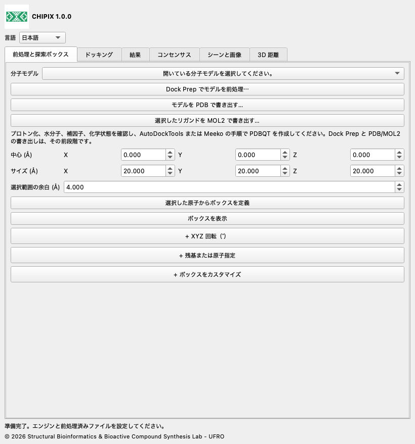

# CHIPIX 1.0.0

**ChimeraX での分子ドッキングとポーズのコンセンサス解析**

CHIPIX 1.0.0 は Structural Bioinformatics & Bioactive Compound Synthesis Lab - UFRO による ChimeraX のネイティブプラグインです。外部 Vina/Smina によるドッキング、ポーズの確認、再現可能な対ごとのコンセンサス解析をドッキング可能なウィンドウに統合します。

[English](../../docs/en/README.md) · [Español](../../docs/es/README.md) · [Deutsch](../../docs/de/README.md) · [Français](../../docs/fr/README.md) · [简体中文](../../docs/zh/README.md) · [日本語](../../docs/ja/README.md) · [Português](../../docs/pt/README.md)

## 機能

- Dock Prep との連携、PDB/MOL2 の書き出し、選択した原子からの探索ボックス作成。
- 剛体 Vina/Smina ドッキングの非同期実行、中止、完全なログ。
- PDBQT/SDF ポーズの読み込み、ネイティブモデル表示、CSV 書き出し。
- 順位平均、AASS、Z スコアによるコンセンサスと、順序または対称性補正による重原子 RMSD。

## ボックスのカスタマイズ、距離、画像

即時編集：「前処理と探索ボックス」で中心とサイズを変更します。XYZ 回転と残基または原子指定は任意の折りたたみ項目で、最初は閉じています。見出しの + をクリックして開きます。同じタブの「+ ボックスをカスタマイズ」で XYZ 移動、拡大・縮小、辺の半径、丸い接合部、球形ハンドル、色、設定の保存・読み込みを行います。輪郭、表面メッシュ、透明な面、非表示を選べます。閉じても設定値は保持されます。メッシュ間隔は表示専用で、計算格子を変更しません。丸い接合部でも探索境界は直方体です。

## インストール

CHIPIX-1.0.0.zip をダウンロードして展開し、bundle_info.xml、README.md、dist/ があるフォルダーを確認します。

ChimeraX を起動し、コマンドラインを表示します。

下のインストールコマンドのパスを実際の展開先に置き換えて実行します。dist/ 内の wheel を使用します。

```text
toolshed install "/FULL/PATH/CHIPIX-1.0.0/dist/chimerax_chipix-1.0.0-py3-none-any.whl"
chipix
```

言語で English、Español、Deutsch、Français、简体中文、日本語、Português を選択します。選択は保存されます。

[インストール](../../docs/ja/INSTALLATION.md) · [ユーザーガイド](../../docs/ja/DOCUMENTATION.md)



## 必要条件

ChimeraX 1.8 以降が必要です。macOS Apple Silicon の ChimeraX 1.12、Python 3.11、Qt6 で統合を検証しました。他の OS やバージョンは検証が必要です。解析と読み込みは Python 標準ライブラリを使用します。ドッキングの実行には、対応する外部 Vina または Smina の実行ファイルと前処理済み PDBQT が必要です。

このソース ZIP には、macOS Apple Silicon 用の公式 Vina 1.2.7 実行ファイルが engines/ に含まれます。wheel にはプラグインのみが含まれます。Windows、Linux、Intel Mac では、公式リリースから対応するエンジンを取得し、参照で選択してください。Smina は別に設定します。コピーした macOS/Linux の実行ファイルに実行権限がない場合は、ターミナルでそのファイルに chmod +x を実行します。

## 現在の対応範囲

- 剛体 Vina/Smina を実行し、Smina では Vinardo を選択できます。Smina は対象環境で実エンジンによる検証が必要です。
- RxDock/ADFR 結果は対応形式・スコア規約へ変換後に解析できます。直接実行は未実装です。
- 自動 PDBQT 前処理、柔軟ドッキング、バッチスクリーニング、コンセンサスクラスタリング、.cxs へのウィンドウ状態保存は未実装です。
- 対ごとのコンセンサスはリガンドライブラリ全体のランキングではありません。入力された座標系 ID は受容体の整列を証明しません。PyMOL との完全な科学的同等性には、同一の前処理と参照系による検証が必要です。

## 検証

記録済みの 1iep テストでは公式の前処理済み入力と Vina 1.2.7 を使用しました。ネイティブツールの 4 ポーズは Vina 直接実行と完全に一致し、最大エネルギー差 0、最大順序 RMSD 0 Å、PDBQT の SHA-256 も一致しました。数値テストは保存した上流参照コードとコンセンサス式を比較します。Qt 統合テストは独立した一時プロファイルを使いますが、画面なしのテストでは OpenGL 描画を検証しません。このリリースでは名称・翻訳・パッケージも検査します。

## GitHub

GitHub 用には ZIP を展開し、CHIPIX-1.0.0 フォルダーの内容をリポジトリのルートにアップロードします。dist/ の wheel を GitHub Release に添付すると利用者がインストールできます。公開はリポジトリ所有者が行います。GitHub URL は仮定していません。

## ライセンスと引用

CHIPIX コードは GPL-3.0-or-later です。LICENSE と NOTICE を参照してください。DockingPie の元のワークフローと式は Serena Rosignoli と Alessandro Paiardini に帰属します。2022 年の Bioinformatics 論文 doi:10.1093/bioinformatics/btac452 と使用エンジンを引用してください。Vina は同梱の Apache-2.0 ライセンスによる独立したプログラムです。

[DockingPie publication](https://doi.org/10.1093/bioinformatics/btac452) · [ChimeraX bundles](https://chimerax.readthedocs.io/en/latest/writing_bundles.html) · [AutoDock Vina](https://github.com/ccsb-scripps/AutoDock-Vina/releases/tag/v1.2.7)

© 2026 Structural Bioinformatics & Bioactive Compound Synthesis Lab - UFRO
