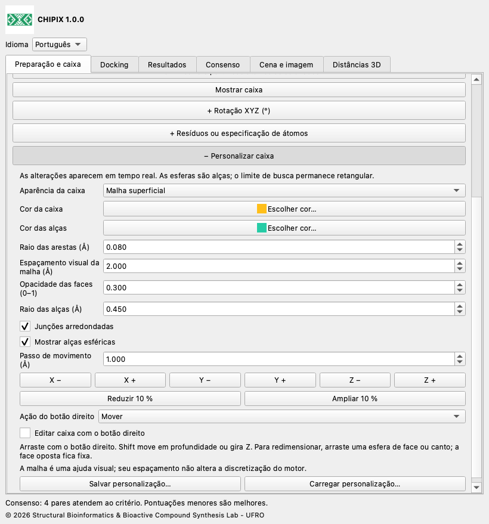
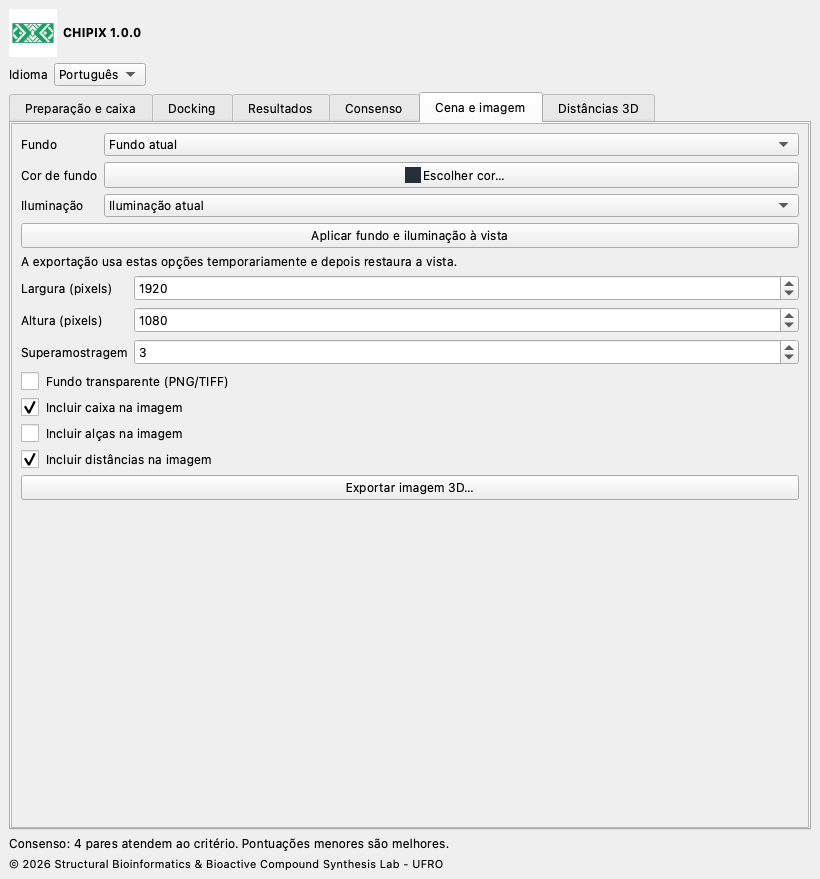

# CHIPIX 1.0.0

## Documentação do usuário

[English](../../docs/en/README.md) · [Español](../../docs/es/README.md) · [Deutsch](../../docs/de/README.md) · [Français](../../docs/fr/README.md) · [简体中文](../../docs/zh/README.md) · [日本語](../../docs/ja/README.md) · [Português](../../docs/pt/README.md)

CHIPIX 1.0.0 é um plugin nativo do ChimeraX do Structural Bioinformatics & Bioactive Compound Synthesis Lab - UFRO. Reúne docking com Vina/Smina externos, inspeção de poses e consenso reproduzível por pares em uma janela acoplável.

## Fluxo de trabalho

1. Abra o modelo do receptor. Em Preparação e caixa, abra Dock Prep e revise protonação, águas, cofatores e estados químicos. Exporte PDB ou o ligante selecionado em MOL2 quando necessário.

2. Gere os PDBQT do receptor e do ligante com seu protocolo validado AutoDockTools ou Meeko. Exportar PDB/MOL2 por si só não gera PDBQT.

3. Selecione átomos do sítio ou do ligante de referência e defina a caixa com margem positiva, ou informe centro e dimensões em Å. A cena e os PDBQT externos devem compartilhar o mesmo sistema de coordenadas.

4. Em Docking, informe executável, arquivos, ID do ligante, ID do receptor/sistema de coordenadas, pasta, exaustividade, poses, faixa de energia, semente e CPU. Reutilize IDs apenas para o mesmo sistema molecular. Execute e verifique o registro.

5. Em Resultados, importe PDBQT com REMARK VINA RESULT ou SDF V2000 com pontuação numérica. Campos automáticos: minimizedAffinity, SCORE, vina_affinity, affinity; é possível informar outro campo. Importe um ligante por arquivo. Pontuações menores são consideradas melhores.

6. Em Consenso, selecione pelo menos duas execuções do mesmo ligante e receptor/sistema de coordenadas. Escolha método, modo RMSD e limiar. Um clique duplo mostra as duas poses. Exporte resultados ou consenso como CSV.

## Personalização da caixa, distâncias e imagens

Edição em tempo real: altere centro e tamanho em Preparação e caixa. Rotação XYZ e Resíduos ou especificação de átomos são seções opcionais, inicialmente recolhidas; clique no cabeçalho + para expandir. + Personalizar caixa, na mesma aba, reúne movimento XYZ, ampliação/redução, raio das arestas, junções arredondadas, alças esféricas, cores e salvar/carregar personalizações. Escolha contorno, malha superficial, faces transparentes ou oculta. Recolher mantém os valores. O espaçamento visual não define a grade computacional. As junções arredondadas mantêm o limite retangular de busca.

Ative Editar caixa com o botão direito e escolha Mover, Redimensionar por uma esfera ou Girar. Arraste na vista 3D. Uma esfera de face ou canto redimensiona mantendo a face/canto oposto fixo. Shift move em profundidade; no modo Girar altera Z. Os ângulos numéricos usam graus e Rz·Ry·Rx. Desativar a edição ou fechar o CHIPIX restaura as atribuições anteriores do botão direito.

Para um sítio específico, digite uma especificação nativa do ChimeraX, por exemplo #1/A:45,67-72, e use Ajustar caixa aos resíduos. Incluir resíduos completos expande uma seleção de átomos aos resíduos inteiros. O ajuste por seleção ou resíduos respeita a rotação e a margem atuais, em coordenadas de cena. Os PDBQT preparados do receptor e ligando devem compartilhar esse sistema de coordenadas; CHIPIX não alinha estruturas independentes.

Docking com rotação: Vina/Smina aceitam caixas alinhadas aos eixos. CHIPIX preserva os PDBQT originais, transforma cópias do receptor e ligando para o sistema local e executa com centro (0,0,0). Depois devolve as poses ao sistema original. run.json registra a transformação e SHA-256 das entradas locais, saída bruta e poses restauradas. PDBQT usa precisão de 0,001 Å. A rotação pode alterar a discretização dos mapas e os resultados; pontuações iguais entre orientações não são garantidas. Com rotação zero, preserva-se o fluxo direto anterior.

Em Distâncias 3D selecione exatamente dois átomos, inclusive de modelos diferentes, e meça. Personalize cor, raio, quantidade de traços (0 é linha contínua), tamanho dos rótulos e valores em 3D. Distâncias e rótulos acompanham o movimento dos modelos. Remova uma medida, limpe o grupo CHIPIX ou exporte CSV. Outros grupos de distâncias do ChimeraX são independentes.

Em Cena e imagem, escolha fundo atual, branco, preto, cinza ardósia ou personalizado e iluminação atual, simples, suave, completa, plana ou padrão. Aplique para visualizar ou exporte usando ajustes temporários com restauração posterior. Configure largura/altura em pixels, superamostragem e inclusão de caixa, alças e distâncias. PNG/TIFF aceitam transparência; JPEG não. A imagem captura a cena 3D sem a janela do complemento. É necessária uma vista OpenGL funcional.

Salvar personalização gera um JSON portátil com geometria, aparência, opções de imagem e estilo das distâncias. O carregamento valida todo o arquivo antes de aplicá-lo. A exportação também cria <nome-imagem>.json com estilo e matriz da câmera. Esses registros não contêm moléculas, seleções ou comando de restauração da câmera: salve uma sessão do ChimeraX separadamente para preservar a cena completa. Para atualizar esta versão 1.0.0, instale o novo wheel com reinstall true e reinicie o ChimeraX.





## Consenso e RMSD

Cada par contém uma pose de cada uma de duas execuções diferentes. A média dos rankings usa posições após ordenar pela energia crescente; empates preservam a ordem do arquivo. AASS calcula a média de (score−mínimo)/(máximo−mínimo). Z-score calcula a média de (score−média)/desvio padrão populacional. A normalização usa todas as poses de cada execução. Um consenso menor é melhor. AASS e Z-score são indefinidos para pontuações constantes; nesse caso use a média dos rankings.

O RMSD exclui hidrogênios e não ajusta, gira ou translada o ligante. O modo por ordem exige números de série, nomes, elementos e ordem coincidentes; nomes PDBQT repetidos são distinguidos pelos números de série. O modo por simetria exige ligações SDF e compara exatamente grafos rotulados por elemento e conectividade, sem ordem de ligação ou estereoquímica como rótulos. O limite é de 200000 nós de busca por par; excedê-lo gera erro, nunca uma aproximação. A análise interativa aceita até 100000 pares. Sem filtro espacial, todos os pares são comparados, o que não demonstra concordância geométrica.

## Arquivos e reprodutibilidade

Cada pasta contém cópias PDBQT do receptor/ligante, poses originais, engine.log e run.json com parâmetros, datas UTC, semente, CPU e SHA-256. Importações também recebem cópia e manifesto. Restaure uma execução concluída pelo run.json e mantenha ou mova a pasta completa. Os campos CSV permanecem em inglês para interoperabilidade; os registros do motor conservam o idioma original. Os PDB derivados de PDBQT são para exibição, têm ligações inferidas e não devem servir de preparação química. SDF é lido nativamente com ligações explícitas.

## Idiomas

Escolha English, Español, Deutsch, Français, 简体中文, 日本語 ou Português em Idioma. A escolha é salva.

## Escopo atual

- Executa Vina e Smina rígidos; Vinardo é oferecido para Smina. Smina ainda precisa de validação real na plataforma de destino.
- Resultados RxDock/ADFR podem ser analisados após conversão para formatos e convenções de pontuação aceitos. A execução direta não está implementada.
- Preparação PDBQT automática, docking flexível, triagem em lote, agrupamento de consenso e salvamento da janela em sessões .cxs não estão implementados.
- Consenso por pares não é um ranking global de bibliotecas. IDs de coordenadas declarados não comprovam alinhamento de receptores. A equivalência científica completa com PyMOL exige preparação idêntica e validação do sistema de referência.

## Validação

O teste 1iep registrado usou entradas oficiais preparadas e Vina 1.2.7. As quatro poses da ferramenta nativa coincidiram exatamente com Vina direto: diferença máxima de energia 0, RMSD máximo por ordem 0 Å e PDBQT idênticos por SHA-256. Os testes numéricos comparam as equações com uma referência original preservada. A integração Qt usa perfil temporário isolado; o teste sem tela não valida renderização OpenGL. A versão acrescenta verificações de identidade, traduções e empacotamento.

compare_results.py compara saídas do mesmo motor em PyMOL e CHIPIX por ranking de pontuação crescente. Use entradas preparadas, binário, função de pontuação, caixa, semente, CPU e parâmetros idênticos. As tolerâncias de energia e RMSD são critérios de comparação configuráveis, não limiares de qualidade biológica. Códigos de saída: 0 sucesso, 1 divergência, 2 entrada inválida.

```bash
python3 compare_results.py pymol.pdbqt chipix.pdbqt \
  --energy-tolerance 0.001 --rmsd-tolerance 0.01 --report comparison.json
```

## Compilação e testes

Execute os comandos a partir da raiz do plugin. Use o Python do ChimeraX para compilar e testar a integração nativa. Os testes da biblioteca padrão funcionam com Python comum; os das fórmulas originais exigem NumPy, presente no ChimeraX testado. O repositório de código é independente.

```bash
python3 -m unittest discover -s tests -v
# ChimeraX Python:
python3.11 build_bundle.py
python3.11 tests/chimerax_smoke.py
```

## Licença e citações

O código CHIPIX usa GPL-3.0-or-later; consulte LICENSE e NOTICE. O fluxo e as equações originais de DockingPie são atribuídos a Serena Rosignoli e Alessandro Paiardini. Cite a publicação de Bioinformatics de 2022, doi:10.1093/bioinformatics/btac452, e os motores usados. Vina é um programa separado sob a licença Apache-2.0 incluída.

© 2026 Structural Bioinformatics & Bioactive Compound Synthesis Lab - UFRO
