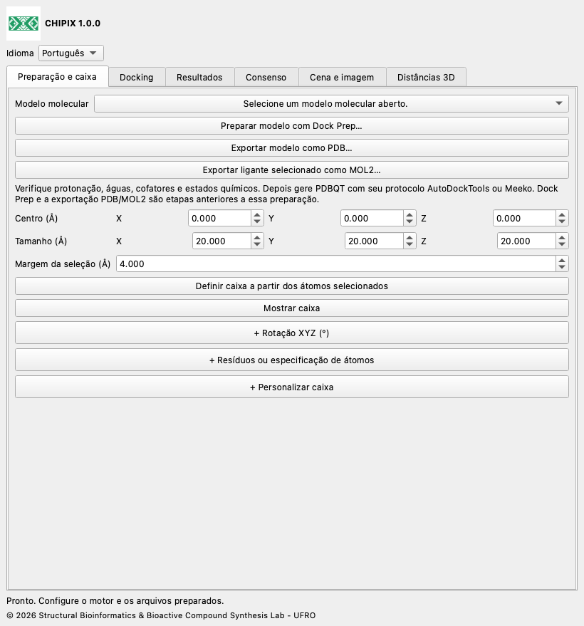

# CHIPIX 1.0.0

**Docking molecular e consenso de poses no ChimeraX**

CHIPIX 1.0.0 é um plugin nativo do ChimeraX do Structural Bioinformatics & Bioactive Compound Synthesis Lab - UFRO. Reúne docking com Vina/Smina externos, inspeção de poses e consenso reproduzível por pares em uma janela acoplável.

[English](../../docs/en/README.md) · [Español](../../docs/es/README.md) · [Deutsch](../../docs/de/README.md) · [Français](../../docs/fr/README.md) · [简体中文](../../docs/zh/README.md) · [日本語](../../docs/ja/README.md) · [Português](../../docs/pt/README.md)

## Recursos

- Integração com Dock Prep, exportação PDB/MOL2 e caixa definida pelos átomos selecionados.
- Docking rígido Vina/Smina assíncrono, cancelamento e registros completos.
- Importação de poses PDBQT/SDF, modelos nativos e exportação CSV.
- Consenso por média dos rankings, AASS e Z-score; RMSD de átomos pesados por ordem ou corrigido por simetria.

## Personalização da caixa, distâncias e imagens

Edição em tempo real: altere centro e tamanho em Preparação e caixa. Rotação XYZ e Resíduos ou especificação de átomos são seções opcionais, inicialmente recolhidas; clique no cabeçalho + para expandir. + Personalizar caixa, na mesma aba, reúne movimento XYZ, ampliação/redução, raio das arestas, junções arredondadas, alças esféricas, cores e salvar/carregar personalizações. Escolha contorno, malha superficial, faces transparentes ou oculta. Recolher mantém os valores. O espaçamento visual não define a grade computacional. As junções arredondadas mantêm o limite retangular de busca.

## Instalação

Baixe CHIPIX-1.0.0.zip e extraia seu conteúdo. Localize a pasta com bundle_info.xml, README.md e dist/.

Abra o ChimeraX e exiba sua linha de comando.

Execute o comando de instalação abaixo, substituindo o caminho pela pasta extraída. Use o wheel em dist/.

```text
toolshed install "/FULL/PATH/CHIPIX-1.0.0/dist/chimerax_chipix-1.0.0-py3-none-any.whl"
chipix
```

Escolha English, Español, Deutsch, Français, 简体中文, 日本語 ou Português em Idioma. A escolha é salva.

[Instalação](../../docs/pt/INSTALLATION.md) · [Documentação do usuário](../../docs/pt/DOCUMENTATION.md)



## Requisitos

Requer ChimeraX 1.8 ou posterior. A integração foi testada no ChimeraX 1.12, Python 3.11 e Qt6 em macOS Apple Silicon. Outros sistemas e versões precisam de validação. A análise e a importação usam a biblioteca padrão do Python. Executar docking exige também um Vina ou Smina externo compatível e entradas PDBQT preparadas.

Este ZIP de código inclui o executável oficial Vina 1.2.7 para macOS Apple Silicon em engines/. O wheel contém somente o plugin. Para Windows, Linux ou Mac Intel, obtenha o motor oficial correspondente e selecione-o com Procurar. Smina é configurado separadamente. Se um binário copiado em macOS/Linux não tiver permissão de execução, aplique chmod +x a esse arquivo em um terminal.

## Escopo atual

- Executa Vina e Smina rígidos; Vinardo é oferecido para Smina. Smina ainda precisa de validação real na plataforma de destino.
- Resultados RxDock/ADFR podem ser analisados após conversão para formatos e convenções de pontuação aceitos. A execução direta não está implementada.
- Preparação PDBQT automática, docking flexível, triagem em lote, agrupamento de consenso e salvamento da janela em sessões .cxs não estão implementados.
- Consenso por pares não é um ranking global de bibliotecas. IDs de coordenadas declarados não comprovam alinhamento de receptores. A equivalência científica completa com PyMOL exige preparação idêntica e validação do sistema de referência.

## Validação

O teste 1iep registrado usou entradas oficiais preparadas e Vina 1.2.7. As quatro poses da ferramenta nativa coincidiram exatamente com Vina direto: diferença máxima de energia 0, RMSD máximo por ordem 0 Å e PDBQT idênticos por SHA-256. Os testes numéricos comparam as equações com uma referência original preservada. A integração Qt usa perfil temporário isolado; o teste sem tela não valida renderização OpenGL. A versão acrescenta verificações de identidade, traduções e empacotamento.

## GitHub

Para GitHub, extraia o ZIP e envie o conteúdo de CHIPIX-1.0.0 como raiz do repositório. Anexe o wheel de dist/ a uma GitHub Release para facilitar a instalação. A publicação é feita pelo proprietário do repositório; nenhuma URL GitHub é presumida.

## Licença e citações

O código CHIPIX usa GPL-3.0-or-later; consulte LICENSE e NOTICE. O fluxo e as equações originais de DockingPie são atribuídos a Serena Rosignoli e Alessandro Paiardini. Cite a publicação de Bioinformatics de 2022, doi:10.1093/bioinformatics/btac452, e os motores usados. Vina é um programa separado sob a licença Apache-2.0 incluída.

[DockingPie publication](https://doi.org/10.1093/bioinformatics/btac452) · [ChimeraX bundles](https://chimerax.readthedocs.io/en/latest/writing_bundles.html) · [AutoDock Vina](https://github.com/ccsb-scripps/AutoDock-Vina/releases/tag/v1.2.7)

© 2026 Structural Bioinformatics & Bioactive Compound Synthesis Lab - UFRO
