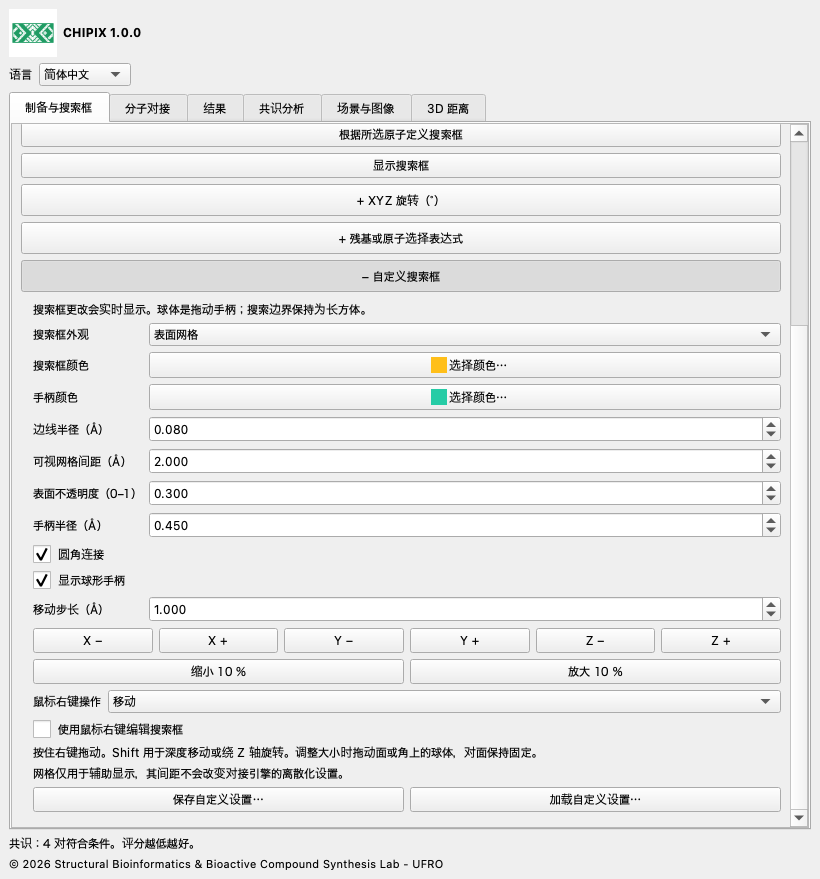
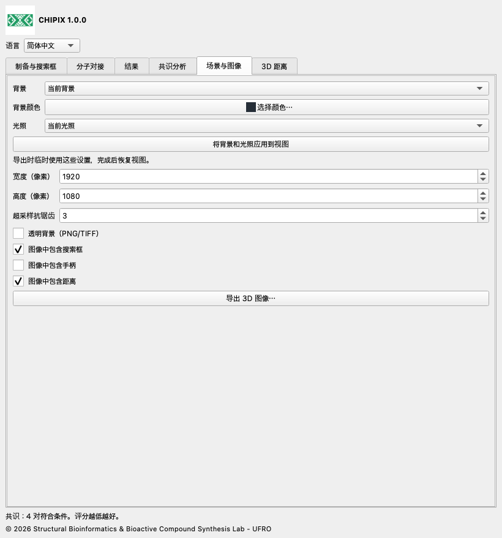

# CHIPIX 1.0.0

## 使用文档

[English](../../docs/en/README.md) · [Español](../../docs/es/README.md) · [Deutsch](../../docs/de/README.md) · [Français](../../docs/fr/README.md) · [简体中文](../../docs/zh/README.md) · [日本語](../../docs/ja/README.md) · [Português](../../docs/pt/README.md)

CHIPIX 1.0.0 是 Structural Bioinformatics & Bioactive Compound Synthesis Lab - UFRO 开发的原生 ChimeraX 插件。它通过可停靠窗口整合外部 Vina/Smina 对接、构象检查和可复现的成对共识分析。

## 工作流程

1. 打开受体模型，在制备与搜索框页打开 Dock Prep，检查质子化、水分子、辅因子和化学状态。需要时将模型导出为 PDB，或将所选配体导出为 MOL2。

2. 按已验证的 AutoDockTools 或 Meeko 流程生成受体和配体 PDBQT。单独导出 PDB/MOL2 并不会生成 PDBQT。

3. 选择结合位点或参考配体原子，以正值边距定义搜索框，或直接输入中心和尺寸，单位为 Å。场景与外部 PDBQT 必须使用相同坐标系。

4. 在分子对接页填写引擎、文件、配体 ID、受体/坐标系 ID、输出位置、搜索强度、构象数、能量范围、随机种子和 CPU 数。仅对同一分子体系复用 ID。开始运行并检查日志。

5. 在结果页导入带 REMARK VINA RESULT 的 PDBQT，或带数值评分的 SDF V2000。自动字段包括 minimizedAffinity、SCORE、vina_affinity、affinity，也可指定自定义字段。每个文件导入一个配体，默认评分越低越好。

6. 在共识分析页选择至少两个相同配体及受体/坐标系的运行，设置方法、RMSD 模式和阈值。双击一行可显示两个构象。结果和共识分析均可导出为 CSV。

## 搜索框自定义、距离与图像

实时编辑：在“准备与搜索框”中调整中心和尺寸。XYZ 旋转及残基或原子选择表达式是可选折叠区，默认收起；点击标题前的 + 展开。在同一选项卡展开“+ 自定义搜索框”，可设置 XYZ 移动、缩放、边线半径、圆角连接、球形手柄、颜色以及保存和加载设置。可选择轮廓、表面网格、透明表面或隐藏。收起不会更改已选参数。网格间距仅用于显示，不改变计算网格。圆角连接不会改变长方体搜索边界。

启用“使用鼠标右键编辑搜索框”，选择移动、拖动球体调整大小或旋转，在 3D 视图内拖动。拖动面或角上的球体可调整大小，对面的面或角保持固定。Shift 用于深度移动；旋转模式下用于 Z 旋转。数值角度单位为度，采用 Rz·Ry·Rx。关闭编辑或关闭 CHIPIX 会恢复之前的右键绑定。

指定结合位点时，输入原生 ChimeraX 原子表达式，例如 #1/A:45,67-72，然后点击“根据残基拟合搜索框”。“包含完整残基”将原子选择扩展到完整残基。按残基或当前选择拟合都会保留当前旋转及边距，并使用场景坐标。预处理的受体和配体 PDBQT 必须已处于同一坐标系；CHIPIX 不会自动对齐无关结构。

旋转对接：Vina/Smina 使用轴对齐搜索框。CHIPIX 保留原始 PDBQT，将受体和配体副本变换到搜索框局部坐标系，以中心 (0,0,0) 运行，然后将构象变换回原场景坐标系。run.json 记录变换，以及局部输入、引擎原始输出和恢复构象的 SHA-256。PDBQT 坐标精度为 0.001 Å。旋转可能改变网格离散化和结果，不保证不同方向获得相同分数。零旋转保留之前的直接运行流程。

在“3D 距离”中选择恰好两个原子，可来自不同模型，然后测量。可设置颜色、线半径、虚线段数（0 为实线）、标签大小和 3D 数值显示。距离与标签随模型移动更新。可单独删除、清空 CHIPIX 距离组或导出 CSV。其他 ChimeraX 距离组独立管理。

“场景与图像”支持当前、白色、黑色、石板灰或自定义背景，以及当前、简单、柔和、完整、平面或默认光照。应用到视图可预览；也可仅在导出时临时应用并在完成后恢复。设置像素宽高、超采样以及是否包含搜索框、手柄和距离。PNG/TIFF 支持透明背景，JPEG 不支持。导出内容为 3D 场景，不含工具窗口，需要可用的 OpenGL 视图。

保存自定义设置会生成可移植 JSON，包含搜索框几何、样式、图像参数和距离样式。加载时先验证整个文件。图像导出还生成 <图像名>.json，记录样式与相机矩阵。这些文件不包含分子结构、原子选择或相机恢复命令；要保留完整场景，请另存 ChimeraX 会话。更新此 1.0.0 版本时，使用 reinstall true 安装新 wheel，然后重启 ChimeraX。





## 共识与 RMSD

每个构象对由两个不同运行各取一个构象组成。平均排名按能量升序排列后取名次平均值，评分相同时保留文件顺序。AASS 平均计算 (score−最小值)/(最大值−最小值)。Z 分数平均计算 (score−均值)/总体标准差。归一化使用每次运行的全部构象。共识值越低越好。评分恒定时 AASS 和 Z 分数无定义，此时可用平均排名。

RMSD 排除氢原子，且不会对配体拟合、旋转或平移。按顺序模式要求序号、名称、元素和原子顺序一致；PDBQT 中重复名称通过序号区分。对称性模式需要 SDF 键信息，精确匹配按元素和连接关系标记的图，不以键级或立体化学作为标签。每对最多搜索 200000 个节点；超过限制会报错，不会返回近似值。交互分析最多支持 100000 个构象对。不使用空间筛选会比较全部构象对，并不证明几何一致。

## 文件与可复现性

每个运行文件夹保存受体/配体 PDBQT 副本、原始构象、engine.log，以及含参数、UTC 时间、随机种子、CPU 和 SHA-256 的 run.json。导入结果也会保存副本和清单。选择 run.json 可恢复已完成的运行，请整体保存或移动文件夹。为便于互操作，CSV 字段名保持英文；引擎日志保留原语言。由 PDBQT 派生的显示 PDB 使用推断键，不能用来进行化学制备。SDF 由原生读取器保留显式键。

## 语言

通过语言菜单选择 English、Español、Deutsch、Français、简体中文、日本語或 Português。选择将被保存。

## 当前范围

- 可运行刚性 Vina 和 Smina；Vinardo 适用于 Smina。Smina 尚需在目标平台进行真实引擎验证。
- RxDock/ADFR 结果转换为支持的格式和评分约定后可分析，尚不支持直接运行这两个引擎。
- 尚未实现自动 PDBQT 制备、柔性对接、批量筛选、共识聚类，以及将窗口状态保存到 .cxs 会话。
- 成对共识不是整个配体库的全局排名。用户填写的坐标系 ID 不能证明外部受体已对齐。与 PyMOL 的完整科学等价性仍需相同制备流程和参考体系验证。

## 验证

已记录的 1iep 测试使用官方预制备输入和 Vina 1.2.7。原生插件生成的四个构象与直接运行 Vina 完全一致：最大能量差为 0，最大按顺序 RMSD 为 0 Å，PDBQT 的 SHA-256 也一致。数值测试将共识公式与保留的上游参考代码比较。原生 Qt 集成使用独立临时配置测试；无屏幕测试不验证 OpenGL 渲染。本版本另有品牌标识、翻译和打包检查。

compare_results.py 按评分升序名次比较 PyMOL 和 CHIPIX 中同一引擎的输出。应使用相同的预制备输入、二进制文件、评分函数、搜索框、随机种子、CPU 和搜索参数。能量及 RMSD 容差是可配置的比较标准，不是生物学质量阈值。退出码：0 通过，1 存在差异，2 输入无效。

```bash
python3 compare_results.py pymol.pdbqt chipix.pdbqt \
  --energy-tolerance 0.001 --rmsd-tolerance 0.01 --report comparison.json
```

## 构建与测试

从插件根目录运行以下命令。构建和原生集成测试应使用 ChimeraX 自带 Python。标准库测试可用普通 Python；上游公式测试需要 NumPy，已测试的 ChimeraX 自带该库。源码仓库可独立使用。

```bash
python3 -m unittest discover -s tests -v
# ChimeraX Python:
python3.11 build_bundle.py
python3.11 tests/chimerax_smoke.py
```

## 许可证与引用

CHIPIX 代码采用 GPL-3.0-or-later，详见 LICENSE 和 NOTICE。DockingPie 原始流程与评分公式归功于 Serena Rosignoli 和 Alessandro Paiardini。请引用其 2022 年 Bioinformatics 论文，doi:10.1093/bioinformatics/btac452，以及所使用的引擎。Vina 是独立程序，随附其 Apache-2.0 许可证。

© 2026 Structural Bioinformatics & Bioactive Compound Synthesis Lab - UFRO
