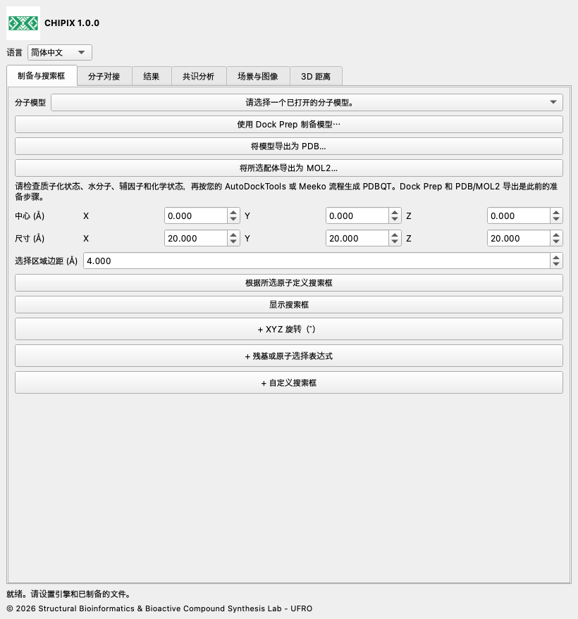

# CHIPIX 1.0.0

**在 ChimeraX 中进行分子对接与构象共识分析**

CHIPIX 1.0.0 是 Structural Bioinformatics & Bioactive Compound Synthesis Lab - UFRO 开发的原生 ChimeraX 插件。它通过可停靠窗口整合外部 Vina/Smina 对接、构象检查和可复现的成对共识分析。

[English](../../docs/en/README.md) · [Español](../../docs/es/README.md) · [Deutsch](../../docs/de/README.md) · [Français](../../docs/fr/README.md) · [简体中文](../../docs/zh/README.md) · [日本語](../../docs/ja/README.md) · [Português](../../docs/pt/README.md)

## 功能

- 集成 Dock Prep，支持 PDB/MOL2 导出和根据所选原子定义搜索框。
- 异步运行刚性 Vina/Smina 对接，支持取消和完整日志。
- 导入 PDBQT/SDF 构象，以原生模型显示并导出 CSV。
- 支持平均排名、AASS 和 Z 分数共识，以及按顺序或经对称性校正的重原子 RMSD。

## 搜索框自定义、距离与图像

实时编辑：在“准备与搜索框”中调整中心和尺寸。XYZ 旋转及残基或原子选择表达式是可选折叠区，默认收起；点击标题前的 + 展开。在同一选项卡展开“+ 自定义搜索框”，可设置 XYZ 移动、缩放、边线半径、圆角连接、球形手柄、颜色以及保存和加载设置。可选择轮廓、表面网格、透明表面或隐藏。收起不会更改已选参数。网格间距仅用于显示，不改变计算网格。圆角连接不会改变长方体搜索边界。

## 安装

下载并解压 CHIPIX-1.0.0.zip，找到包含 bundle_info.xml、README.md 和 dist/ 的文件夹。

打开 ChimeraX 并显示命令行。

执行下方安装命令，将路径替换为实际解压路径，使用 dist/ 中的 wheel 文件。

```text
toolshed install "/FULL/PATH/CHIPIX-1.0.0/dist/chimerax_chipix-1.0.0-py3-none-any.whl"
chipix
```

通过语言菜单选择 English、Español、Deutsch、Français、简体中文、日本語或 Português。选择将被保存。

[安装](../../docs/zh/INSTALLATION.md) · [使用文档](../../docs/zh/DOCUMENTATION.md)



## 系统要求

需要 ChimeraX 1.8 或更高版本。已在 macOS Apple Silicon 上使用 ChimeraX 1.12、Python 3.11 和 Qt6 测试集成；其他系统和版本尚需验证。分析和导入仅使用 Python 标准库。运行对接还需要兼容的外部 Vina 或 Smina 可执行文件，以及已制备的 PDBQT 输入。

此源码 ZIP 在 engines/ 中附带官方 Vina 1.2.7 的 macOS Apple Silicon 可执行文件。wheel 仅包含插件。Windows、Linux 或 Intel Mac 用户应从官方发布页取得对应引擎，再通过浏览选择。Smina 单独配置。若复制后的 macOS/Linux 可执行文件缺少执行权限，可在终端对该文件运行 chmod +x。

## 当前范围

- 可运行刚性 Vina 和 Smina；Vinardo 适用于 Smina。Smina 尚需在目标平台进行真实引擎验证。
- RxDock/ADFR 结果转换为支持的格式和评分约定后可分析，尚不支持直接运行这两个引擎。
- 尚未实现自动 PDBQT 制备、柔性对接、批量筛选、共识聚类，以及将窗口状态保存到 .cxs 会话。
- 成对共识不是整个配体库的全局排名。用户填写的坐标系 ID 不能证明外部受体已对齐。与 PyMOL 的完整科学等价性仍需相同制备流程和参考体系验证。

## 验证

已记录的 1iep 测试使用官方预制备输入和 Vina 1.2.7。原生插件生成的四个构象与直接运行 Vina 完全一致：最大能量差为 0，最大按顺序 RMSD 为 0 Å，PDBQT 的 SHA-256 也一致。数值测试将共识公式与保留的上游参考代码比较。原生 Qt 集成使用独立临时配置测试；无屏幕测试不验证 OpenGL 渲染。本版本另有品牌标识、翻译和打包检查。

## GitHub

上传 GitHub 时，解压 ZIP，将 CHIPIX-1.0.0 文件夹的内容作为仓库根目录上传。将 dist/ 中的 wheel 附加到 GitHub Release，便于用户安装。发布由仓库所有者完成；此处不预设 GitHub 地址。

## 许可证与引用

CHIPIX 代码采用 GPL-3.0-or-later，详见 LICENSE 和 NOTICE。DockingPie 原始流程与评分公式归功于 Serena Rosignoli 和 Alessandro Paiardini。请引用其 2022 年 Bioinformatics 论文，doi:10.1093/bioinformatics/btac452，以及所使用的引擎。Vina 是独立程序，随附其 Apache-2.0 许可证。

[DockingPie publication](https://doi.org/10.1093/bioinformatics/btac452) · [ChimeraX bundles](https://chimerax.readthedocs.io/en/latest/writing_bundles.html) · [AutoDock Vina](https://github.com/ccsb-scripps/AutoDock-Vina/releases/tag/v1.2.7)

© 2026 Structural Bioinformatics & Bioactive Compound Synthesis Lab - UFRO
